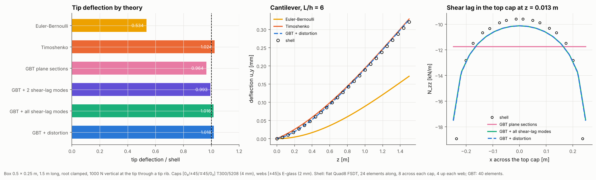
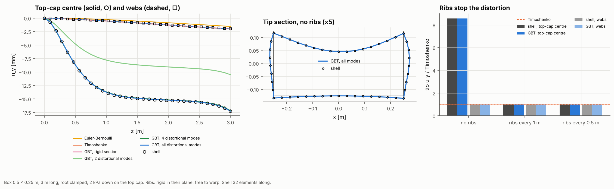
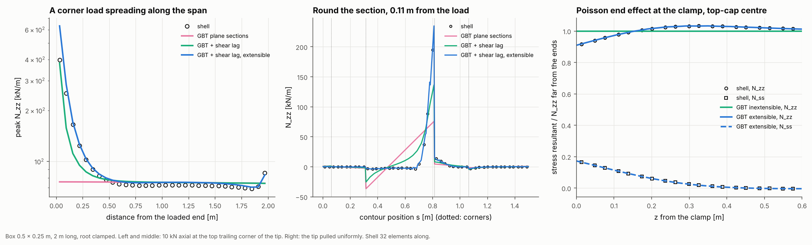

# 04 · Box spar bending and axial load: shear, shear lag, distortion and end effects

Example 01 took torsion from Saint-Venant through restrained warping to distortion.
This example does the same for **bending** and **axial load**, on the same carbon/glass
box spar, with a shell model of the box as the reference.

**Bending**

1. **Euler-Bernoulli.** Plane sections stay plane and normal to the axis: the classical
   4 × 4 stiffness, no shear strain.
2. **Timoshenko.** The section also shears. GA comes from the thin-wall shear flows
   (`ThinWalledSection.timoshenko_stiffness`, example 03) and the beam is solved with
   `TimoshenkoBeam`.
3. **Shear lag (GBT warping modes).** The caps' axial stress is not uniform across
   their width near the clamp, because the shear flow that feeds the stress in also
   shears the caps. Plane sections cannot show it.
4. **Distortion (GBT distortional modes).** A pressure on one cap bends that cap and
   the webs across the section. No rigid-section beam, Timoshenko included, sees it.
   Ribs stop it.

**Axial load**

1. **Uniform extension.** N / EA, the same strain everywhere.
2. **Shear lag.** A load at one corner spreads over the section only gradually along
   the span.
3. **End effects (extensible GBT).** At a clamp the walls cannot contract sideways, so
   hoop stress appears and the axial stress drops. Walls that can carry hoop stress
   (`extensible=True`) are also what lets a point load diffuse as a plane-stress problem.







## The API

```python
section = ThinWalledSection.from_blade_mesh(box, z=0.75)
K6 = section.timoshenko_stiffness(section.shear_centre)        # or beam_section_properties(...).stiffness_6x6

beam = TimoshenkoBeam(K6, length=1.5, n_elements=4)            # shear=False, or a 4 x 4: Euler-Bernoulli
sol = beam.clamp(0.0).add_force(1.5, [0, 1e3, 0]).solve()      # add_distributed, pin, fix, off-axis points
sol.node_displacement(1.5), sol.displacement(z), sol.section_forces(z), sol.reaction(0.0)

gbt = GeneralizedBeam(section, 1.5, warping="full", distortional_modes=None, extensible=True)
gbt.clamp(0.0).diaphragm(1.5)
gbt.add_section_force(1.5, (0, 1e3))                 # a shear force through a rib
gbt.add_distributed_wall_load(caps, (0, -1e3))       # a pressure on a skin, per unit span
gbt.add_axial_force(1.5, 1e4, point=(0.25, 0.125))   # axial load, spread or at a point
sol = gbt.solve()
sol.section_displacement(z), sol.wall_resultants(z)  # N_zz (and N_ss when extensible) per wall
```

`TimoshenkoBeam` takes any 6 × 6 section stiffness and keeps every coupling. Each
element is exact: its flexibility is the integral of the section compliance along a
cantilever, carried to the element end by equilibrium, so one element per load or
support point already gives the exact answer for point loads and uniform distributed
loads, and the displacements inside an element are recovered exactly too.

`GeneralizedBeam`'s warping modes give the shear lag (`warping="classical"` is plane
sections plus the Benscoter torsional warping; an integer keeps that many extra modes;
`"full"` keeps one per section point), its distortional modes give the in-plane
deformation, and `extensible=True` keeps the hoop strain and the full wall ABD.

## The model

| Item | Value |
|---|---|
| Box | 0.5 × 0.25 m (wall mid-lines), root clamped |
| Caps | [0₂/45/−45/−45/45/0₂] T300/5208, 8 × 0.5 mm |
| Webs | [±45]s E-glass, 4 × 0.5 mm |
| Shell | Flat Quad8 FSDT on the wall mid-surfaces, 8 elements across each cap and 4 up each web |
| Bending | 1.5 m long (L/h = 6), 24 shell elements along, 1 kN vertical at the tip through a tip rib |
| Cap pressure | 3 m long, 32 elements along, 2 kPa down on the top cap, ribs at the spacings shown |
| Axial | 2 m long, 32 elements along; 10 kN at the top trailing corner of the tip, or the tip pulled uniformly |
| GBT | 40 elements, graded towards the clamp and the ribs |

Section: EI_flap = 6.564 MN m², GA_y = 9.546 MN (the thin-wall shear stiffness about
the shear centre).

```bash
python examples/04_box_spar_bending_axial/box_spar_bending_axial.py           # about 12 min
python examples/04_box_spar_bending_axial/box_spar_bending_axial.py --reuse   # redraw from data/results.json
```

## Results

**Bending of a short cantilever** (L/h = 6, tip deflection):

| Model | Tip [mm] | / shell |
|---|---:|---:|
| Euler-Bernoulli | 0.1714 | 0.534 |
| Timoshenko | 0.3285 | 1.024 |
| GBT, plane sections | 0.3094 | 0.964 |
| GBT + 2 shear-lag modes | 0.3186 | 0.993 |
| GBT + all shear-lag modes | 0.3261 | 1.016 |
| GBT + distortion | 0.3267 | 1.018 |
| Shell | 0.3208 | |

- At L/h = 6 the shear deflection is most of the answer: Euler-Bernoulli gives barely
  half of it. Timoshenko with the thin-wall GA is within 2.4% of the shell.
- GBT's plane-section run is 3.6% soft and its full warping 1.6% stiff, so GBT brackets
  the shell from a different direction than Timoshenko does: GBT's shear deformation
  comes out of the wall shear stiffnesses rather than a shear correction factor, and it
  keeps the walls inextensible and hoop-stress-free. Two shear-lag modes are enough to
  land within 1%.
- Adding the distortional modes changes the deflection by 0.2%: a tip shear through a
  rib hardly distorts the box.

**Shear lag in the top cap** at the first Gauss line (z = 0.013 m, N_zz [kN/m]):

| | Cap centre | Cap edge (at the web) |
|---|---:|---:|
| Plane sections | −11.76 | −11.76 |
| GBT + all shear-lag modes | −10.13 | −17.45 |
| Shell | −9.60 | −18.93 |

- The stress at the cap edges is 60% above the plane-section value and the stress at the
  centre is 18% below it. A spar cap sized on EI alone would be under-sized at the web
  joints near a clamped root or a bolted joint. GBT reproduces the shape; the shell's
  very last point sits above GBT's because the shear flow enters at the corner node.
- The lag decays within about one section depth of the clamp, so it matters at roots,
  joints and ply drops, not along the free span.

**A pressure on one cap** (2 kPa down on the top cap, tip u_y [mm]):

| Ribs | Shell: cap centre / webs | GBT, all modes | GBT, rigid section |
|---|---:|---:|---:|
| none | −17.27 / −1.98 | −17.26 / −2.01 | −2.01 / −2.01 |
| every 1 m | −1.98 / −1.98 | −2.01 / −2.01 | −2.01 / −2.01 |
| every 0.5 m | −1.97 / −1.97 | −2.01 / −2.01 | −2.01 / −2.01 |

(Timoshenko gives −2.01 mm, Euler-Bernoulli −1.54 mm.)

- The beam deflection of the box is 2 mm. The unsupported cap bows another 15 mm into
  the box, nearly nine times the beam deflection, and only the distortional modes see
  it. The webs move with the beam, which is why a beam model is still right for the
  overall deflection and wrong for the skin.
- 2 distortional modes give 61% of the cap deflection and 4 give 99.6%: the cap bowing
  is spread over several modes, unlike the single racking mode of torsion (example 01).
- Ribs every 1 m remove it: the cap and web deflections come back together on the
  Timoshenko value, and shell and GBT agree within 1.5%.

**An axial load at one tip corner** (10 kN, peak N_zz [kN/m]; uniform is 75):

| Distance from the load | Shell | Plane sections | + shear lag | + shear lag, extensible |
|---|---:|---:|---:|---:|
| 0.03 m | 397 | 76 | 381 | 631 |
| 0.16 m | 166 | 76 | 111 | 170 |
| 0.34 m | 90 | 76 | 82 | 91 |
| 0.66 m | 73 | 76 | 76 | 75 |

- The load has spread over the section within about 0.5 m, a little over one box width:
  Saint-Venant's principle, measured.
- Within that length the extensible GBT follows the shell (within 3% beyond 0.1 m),
  while the inextensible one under-predicts the peak by a third: the load diffuses
  sideways through the wall as a plane-stress problem, which needs hoop stress. Right
  at the load both the shell and GBT are mesh-dependent, as a point load on a membrane
  is singular.
- Round the section (middle panel) the stress is concentrated in the loaded cap and
  the adjacent web, with plane sections spreading it linearly across the whole box.

**Poisson end effect at a clamp** (tip pulled uniformly, top-cap centre, scaled by the
far-field N_zz):

| | At the clamp | 0.1 m | 0.2 m |
|---|---:|---:|---:|
| Shell N_zz | 0.918 | 0.971 | 1.015 |
| Shell N_ss | 0.165 | 0.114 | 0.061 |
| GBT extensible N_zz | 0.909 | 0.971 | 1.016 |
| GBT extensible N_ss | 0.172 | 0.114 | 0.061 |
| GBT inextensible N_zz | 1.000 | 1.000 | 1.000 |

- The clamp stops the walls contracting across their width, which raises a hoop stress
  of about ν times the axial one and takes 8% off the axial stress. It dies out within
  0.2 m, about one box width, and is matched by the extensible GBT point for point.
  The inextensible run cannot show it at all.
- The same effect is why the shell's shear stiffness runs a few percent above thin-wall
  theory when ν > 0 (Cowper's correction, example 03).

## Notes

- `TimoshenkoBeam` is checked against the closed forms in `tests/test_timoshenko_beam.py`
  (cantilever point and uniform loads, simply supported, Euler-Bernoulli, an off-axis
  force) and for mesh independence with a fully coupled random 6 × 6.
- The GBT section, wall and axial loads are checked against the slender-beam limit and
  against N_ss = ν N_zz at a clamp in the same file.
- Extensible GBT costs more: it keeps 3 in-plane degrees of freedom per section point
  instead of the inextensible subspace, so use it for end effects and point-load
  diffusion, not for the overall response.
- Linear static, prismatic sections. The shell is the reference here, not an exact
  solution; its own mesh convergence is covered by composite-laminate-model's examples [03](https://github.com/samhughes-fea/composite-laminate-model/tree/main/examples/03_result_fidelity) and [26](https://github.com/samhughes-fea/composite-laminate-model/tree/main/examples/26_mid_surface_meshing).
