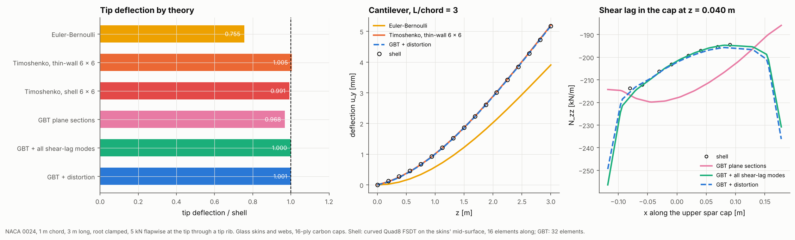
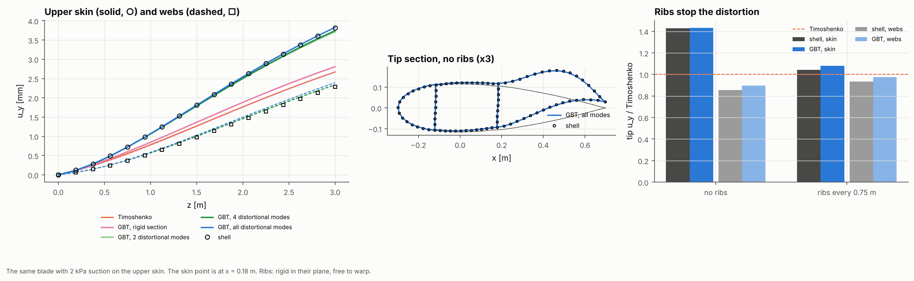
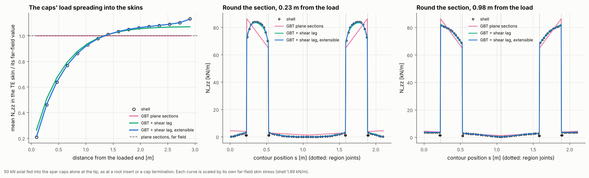

# 05 · Blade bending and axial load: shear, shear lag, distortion and diffusion

Example 04 took bending and axial load beyond Euler-Bernoulli on a rectangular box.
This example does the same on the three-cell blade section of composite-laminate-model's [example 20](https://github.com/samhughes-fea/composite-laminate-model/tree/main/examples/20_blade_beam_properties) and example 02
(NACA 0024, 1 m chord, glass skins and webs, 16-ply carbon spar caps), where the caps
are 22 times stiffer per unit length than the skins and the section is far from rigid
in its plane. Everything is checked against a shell model of the same blade (curved
Quad8 FSDT, skins on their mid-surface).

1. **Euler-Bernoulli → Timoshenko**, with the 6 × 6 from thin-wall theory and the
   shell's own 6 × 6 from `beam_section_properties`, solved with `TimoshenkoBeam`.
2. **Shear lag** (GBT warping modes): the axial stress across the spar cap at the
   clamped root.
3. **Distortion** (GBT distortional modes): suction on the upper skin, and ribs.
4. **Diffusion**: an axial load fed into the caps alone, as at a root insert or a cap
   termination, spreading into the skins along the span.







## The model

| Item | Value |
|---|---|
| Section | NACA 0024, 1 m chord, pitch axis at 0.3c, 3 m long (L/chord = 3), root clamped |
| Skins | [0/±45/∓45/0] E-glass (3 mm); leading-edge panel 0–0.18c, trailing-edge panel 0.48–1.0c |
| Caps | [0]₁₆ T300/5208 (8 mm), 0.18–0.48c |
| Webs | [±45]s E-glass (2 mm) at 0.18c and 0.48c |
| Shell | Curved Quad8 FSDT on the skins' mid-surface, 16 elements along the span |
| GBT | 32 elements, graded towards the clamp and the ribs |
| Loads | 5 kN flapwise at the tip through a tip rib; 2 kPa suction on the upper skin; 50 kN axial into the caps alone at the tip |

Section: EI_flap = 11.52 MN m², GA_flap = 11.64 MN (thin-wall) and 12.29 MN (the
shell's own 6 × 6; the Poisson effect of example 03).

```bash
python examples/05_blade_bending_axial_hierarchy/blade_bending_axial_hierarchy.py           # about 6 min
python examples/05_blade_bending_axial_hierarchy/blade_bending_axial_hierarchy.py --reuse   # redraw from data/results.json
```

## Results

**Flapwise tip force** (5 kN through a tip rib, tip deflection):

| Model | Tip [mm] | / shell |
|---|---:|---:|
| Euler-Bernoulli | 3.905 | 0.755 |
| Timoshenko, thin-wall 6 × 6 | 5.194 | 1.005 |
| Timoshenko, shell 6 × 6 | 5.125 | 0.991 |
| GBT, plane sections | 5.003 | 0.968 |
| GBT + all shear-lag modes | 5.169 | 1.000 |
| GBT + distortion | 5.173 | 1.001 |
| Shell | 5.170 | |

- At L/chord = 3 the shear deflection is a quarter of the total, and Euler-Bernoulli
  misses all of it. Both 6 × 6 matrices land within 1%: thin-wall theory 0.5% soft and
  the shell's own 6 × 6 0.9% stiff (its GA is 5.6% higher, the Poisson effect of
  example 03, but it only changes a quarter of the answer).
- GBT with plane sections is 3.2% soft and with the shear-lag modes exact to three
  figures. Distortion adds 0.1%: a tip shear through a rib hardly distorts the
  section.

**Shear lag across the upper spar cap** at the first Gauss line (z = 0.040 m, N_zz
[kN/m], compression):

| | Range across the cap |
|---|---|
| Plane sections | −220 to −186 (a straight line in x) |
| GBT + all shear-lag modes | −256 to −195 |
| Shell | −214 to −195 |

- Plane sections put the peak at the leading edge of the cap and the minimum at the
  trailing edge, following the chordwise position alone. With shear lag the stress
  peaks at both web joints, where the shear flow feeds it in, and the shape follows
  the shell. GBT overshoots the forward peak by 20% at the very first Gauss line, and
  the two agree within a few percent from the second row on.
- The correction is worth 10% of the cap stress at a clamped root. It decays within
  about a chord.

**Suction on the upper skin** (2 kPa, tip u_y, skin point at x = 0.18 m):

| Ribs | Shell: skin / webs | GBT, all modes | GBT, rigid section |
|---|---:|---:|---:|
| none | 3.816 / 2.281 | 3.828 / 2.392 | 2.807 / 2.807 |
| every 0.75 m | 2.783 / 2.493 | 2.881 / 2.606 | 2.807 / 2.807 |

(Timoshenko gives 2.671 mm.)

- Unlike the box of example 04, the blade section's beam deflection and its distortion
  are the same order: the skin moves 43% more than the beam does and the webs 15% less,
  because the suction also pulls the section open between the webs. A beam model gives
  neither number.
- 2 distortional modes already give 89% of the extra skin deflection and 4 give 92%;
  the rest is spread thinly over the remaining modes. The curved skins have no single
  soft mode like the box's racking mode.
- Ribs every 0.75 m bring the skin and the webs back to within 5% of the Timoshenko
  deflection. GBT tracks the shell within 4% with ribs and 3% without.

**An axial load into the caps alone** (50 kN at the tip, mean N_zz in the
trailing-edge skin, each model scaled by its own far-field value):

| Distance from the load | Shell | Plane sections | + shear lag | + shear lag, extensible |
|---|---:|---:|---:|---:|
| 0.28 m | 0.46 | 1.00 | 0.51 | 0.47 |
| 0.66 m | 0.77 | 1.00 | 0.79 | 0.77 |
| 1.03 m | 0.93 | 1.00 | 0.94 | 0.93 |
| 1.41 m | 1.01 | 1.00 | 1.01 | 1.01 |
| 2.91 m | 1.13 | 1.00 | 1.07 | 1.13 |

Far-field skin stress: shell 1.89 kN/m, extensible GBT 1.89, GBT with shear lag 1.92,
plane sections 2.04 kN/m.

- The load takes about 1.4 m, well over a chord, to reach the skins. That is much
  further than the box spar's half metre in example 04, because the skins are so much
  softer than the caps: the shear lag length grows with the stiffness ratio. A cap
  termination or a root insert needs that much span before plane sections hold.
- Round the section (middle and right panels) the shell and GBT agree point for point
  once the shear-lag modes are in; plane sections put a straight line across the chord
  and miss both the plateau in the caps and the near-zero skins.
- Unlike the box spar's point load, hoop stress hardly matters here: the extensible run
  differs from the inextensible one by under 5%, because the load is spread along the
  caps rather than concentrated at a corner. It does pin down the far field, where the
  inextensible run reads 2% high.

## Notes

- The shell's Gauss points are assigned to the wall whose mid-point is nearest, so the
  stiff caps do not leak into the skin average: with a radius-based mask instead, the
  "skin" stress comes out nearly three times too high.
- `TimoshenkoBeam` and the GBT loads are checked against closed forms in
  `tests/test_timoshenko_beam.py`.
- The section is prismatic and the analysis linear static. The shell is the reference
  here, not an exact solution.
