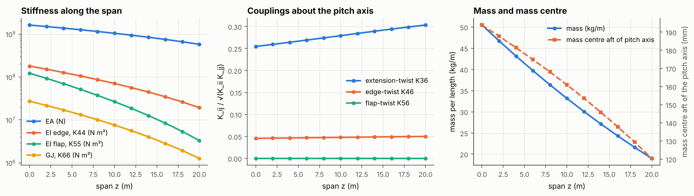

# 07 · Blade properties for OpenFAST BeamDyn and windIO

`BeamDynBlade` sweeps a blade: it cuts a `BladeGeometry` at each station, builds the
`ThinWalledSection` of every cut, and writes the beam model OpenFAST's BeamDyn reads
(a primary input file with the reference axis and twist, and a blade file with the
6 × 6 stiffness and mass at each station) and the windIO 2.0 blade fields WISDEM reads.
It reads both formats back. This example checks the files against the IEA 15 MW
reference turbine's, runs them in BeamDyn, and writes a tapered blade.



```bash
python examples/07_beamdyn_windio_export/beamdyn_windio_export.py
BEAMDYN_DRIVER=/path/to/beamdyn_driver python examples/07_beamdyn_windio_export/beamdyn_windio_export.py
python examples/07_beamdyn_windio_export/beamdyn_windio_export.py --reuse   # redraw only
```

The IEA 15 MW files (public, Apache-2.0) are downloaded from the
[IEA-15-240-RWT repository](https://github.com/IEAWindTask37/IEA-15-240-RWT) at a fixed
commit into `data/reference/`, which git ignores. The BeamDyn runs need OpenFAST's
`beamdyn_driver` (`cmake .. && make beamdyn_driver` in an OpenFAST checkout, 4.x or
5.x); without it they are skipped.

## Using it

```python
from anisotropic_section_model import BeamDynBlade

blade = BeamDynBlade.from_geometry(geo, laminates, z=np.linspace(0.0, 20.0, 11))
blade.write("blade_BeamDyn.dat", damping=[3e-3] * 6)   # + blade_BeamDyn_blade.dat
blade.write("blade_BeamDyn.dat", version=4)            # for OpenFAST 3 and 4
blade.write_windio("blade.yaml")                       # components.blade fields
blade.stiffness, blade.mass, blade.key_points, blade.twist, blade.eta
```

`laminates` can be a function of z, for layups that change along the span. Sections
you already have (from `from_blade_mesh`, say) go through `BeamDynBlade.from_sections`.

## Axes

BeamDyn's blade frame has X towards the suction side, Y towards the trailing edge and Z
along the span, and each station's matrices are about the reference (pitch) axis in the
chord-aligned frame that BeamDyn turns by the initial twist. The geometry kernel's frame
(x towards the trailing edge, y towards the suction side) is a mirror image of it, so
the export swaps x and y and flips the sign of the moments and rotations, which are
pseudo-vectors, the same mirror example 03 applies before comparing with the published
IEA 15 MW matrices. The kernel's positive twist turns the leading edge towards the
suction side and BeamDyn's towards the pressure side, so the twist changes sign; a
section cut at any twist gives the same local matrices (`tests/test_beamdyn_export.py`).

windIO 2.0's `elastic_properties` are the same numbers: WISDEM writes them into BeamDyn
unchanged. In the IEA 15 MW files, K44 is the edgewise and K55 the flapwise bending
stiffness, `cm_y` is the mass centre's distance towards the trailing edge, and
`i_edge`, `i_flap` and `i_cp` are BeamDyn's M44, M55 and −M45.

## Results

| Check | Result |
|---|---|
| IEA 15 MW windIO file → BeamDyn blade file, against the official `IEA-15-240-RWT_BeamDyn_blade.dat` (26 stations) | stiffness to 1.9e-12 and mass to 3.5e-19 of the largest entry. The stiffness difference is the official file's own asymmetry (3.7e-12), which the export averages out |
| Official IEA 15 MW deck read and rewritten (OpenFAST 4 and 5 formats) | read back bit for bit |
| BeamDyn (OpenFAST 4.1.2 and 5.0.0), 100 kN flapwise tip load on the IEA 15 MW blade | 8.2054 m tip deflection from the official deck and from the deck written from windIO |
| BeamDyn against `TimoshenkoBeam` on the section: 20 m blade, 12° twist, off the pitch axis, 20° caps (all strains coupled), six tip loads and self-weight in three directions | largest tip difference 1.7e-5 of the tip motion; the axial and moment loads agree to 1e-9, and the rest is BeamDyn's geometric nonlinearity, which grows with the load |
| NREL 5 MW (OpenFAST r-test, 49 stations): deck read and rewritten | the same BeamDyn tip deflection, 7.3612 m under 100 kN |

The tapered blade (NACA 0030, 2 m chord, 10° twist at the root to NACA 0018, 1 m, 0° at
the tip; 0.4 m prebend; 2D-CN layout with carbon caps at 15° thinning from 12 mm to
7 mm) is written to [`data/tapered_BeamDyn.dat`](data/tapered_BeamDyn.dat),
[`data/tapered_BeamDyn_blade.dat`](data/tapered_BeamDyn_blade.dat) (OpenFAST 5) and
[`data/tapered_windio.yaml`](data/tapered_windio.yaml). Its caps at the same angle in
both skins give an extension-twist coupling of 0.25 to 0.30 (K36 / √(K33 K66)); the
flapwise bending-twist coupling would need opposite angles.

## Limitations

- Sections are cut normal to z; BeamDyn takes them normal to its curved reference
  axis. The difference is second order in the slope of the prebend and sweep.
- BeamDyn's reference axis here passes through the stations' pitch-axis points (one
  member, the stations as key points). Trapezoidal quadrature between few stations is
  coarse: the IEA 15 MW deck uses `refine=2`, and `refine=1` reads 2% more tip
  deflection.
- The windIO export holds the beam fields only (reference axis, twist, elastic
  properties); merge them into a turbine file for WISDEM. windIO requires
  `structural_damping`, which is written only if given.
