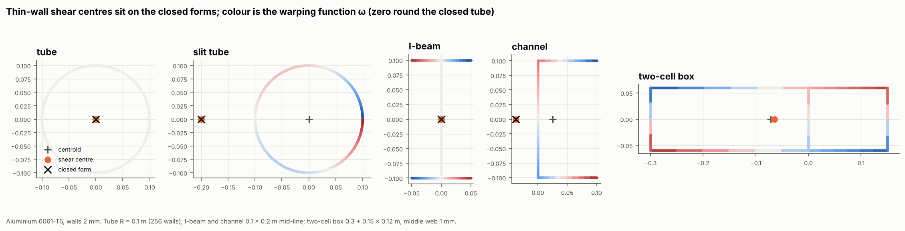
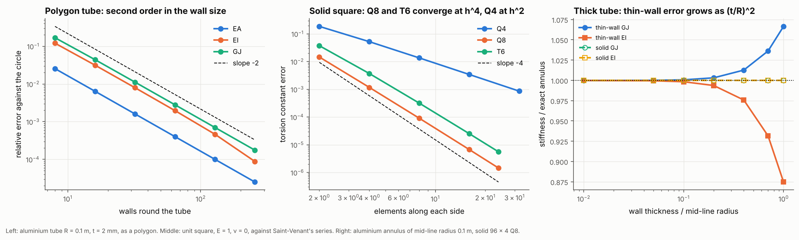

# 08 · Isotropic sections against the closed forms

The place to start. Before laminates, couplings and blades, both section engines are run
on aluminium sections whose answers are in every textbook, and checked against them:
thin-wall theory (`ThinWalledSection`) on tubes, open sections and a two-cell box, and the
solid 2D finite-element section (`SolidSectionAnalysis`) on rectangles and thick tubes.
The last part shows where thin-wall theory stops being accurate.

```bash
python examples/08_isotropic_sections/isotropic_sections.py          # about 25 s
python examples/08_isotropic_sections/isotropic_sections.py --reuse  # redraw and re-check only
```



## The physics

**Closed and open sections twist in different ways.** In a closed tube the torque is
carried by a shear flow q that runs round the cell (Bredt-Batho): GJ = 4A²/∮ds/(Gt), which
for a ring is G·2πR³t. Slit the same tube along its length and that flow has nowhere to
go. Each wall can only twist on its own, as a thin strip, and GJ drops to G·2πRt³/3.
For R/t = 50 that is 7,500 times softer. The slit tube in the figure has GJ = 43 N m²
against 325,500 N m² for the closed one.

**Open sections warp, and warping has a stiffness.** When an open section twists, its
points also move along the beam axis by ω(s)·θ′, where ω is the sectorial coordinate (the
colour in the figure). If a support stops that warping, the axial stresses resist the
twist with the warping constant EΓ = ∫ E t ω² ds (Vlasov). For the I-beam,
Γ = t b³ h²/24. A closed tube's ω is zero, which is why it has no colour.

**The shear centre** is the point a shear force must pass through to bend the section
without twisting it. In the code it is the pole that makes ω orthogonal to bending. Two
cases show it clearly:
- The channel's shear centre sits outside the section, 3b²/(h + 6b) behind the web.
- The slit tube's is 2R from its centre, on the side away from the slit.

**Several cells share their walls.** In the two-cell box the middle web carries the
difference of the two cells' flows. Each cell twists at the same rate, which gives one
compatibility equation per cell (Bredt-Batho for several cells). Its flow ratio
q₂/q₁ = 0.923 is reproduced to round-off.

**The solid section** solves the 2D elasticity problem of the cross-section (warping in
all three directions) by finite elements, so it needs no thin-wall assumption.
- On a rectangle it reproduces Saint-Venant's series for the torsion constant at every
  aspect ratio.
- With ν = 0 it gives the shear factor 5/6. With ν = 0 the exact shear stress is the
  parabola τ = 3V/2A·(1 − 4z²/h²). With ν > 0 the anticlastic curvature changes it
  slightly, which a solid analysis captures and a Timoshenko factor does not.

## Results

| Section | Term | Computed / closed form |
| --- | --- | --- |
| Tube, R/t = 50 (256 walls) | EA, EI, GJ, shear factor 1/2 | 0.99997, 0.99991, 0.99982, 1.00002 |
| Slit tube | GJ, shear centre −2R, EΓ = 2πR⁵t(π²/3 − 2) | 0.99996, 0.99991, 0.99971 |
| I-beam | GJ, EΓ = t b³h²/24 | 1.00000, 1.00019 |
| Channel | shear centre, EΓ | 0.99993, 1.00030 |
| Two-cell box | GJ, flow ratio q₂/q₁ | 1.00000, 1.00000 |
| Solid rectangles 1:1 to 10:1 (8 × 8 per square, Q8) | J (series), shear factor (5/6) | within 1e-4 |
| Solid annulus, t = R | GJ, EI (exact) | within 1e-7 |

The remaining thin-wall errors come from two sources: the polygon is not quite a circle,
and the open sections' corners overlap at the mid-line. Both shrink with the wall size.



- **Left:** a tube made of n flat walls converges to the circle at second order in the
  wall size.
- **Middle:** the solid square's torsion constant converges at h⁴ with the quadratic
  elements (Q8 and T6) and at h² with the bilinear Q4. Q8 is the default.
- **Right:** thin-wall theory puts all the material on the mid-line. Against the exact
  annulus it is within 0.1 % up to t/R = 0.1 and 1.3 % at t/R = 0.4, then drifts off
  as (t/R)²: GJ is 7 % high and EI 12 % low at t = R. The solid section stays exact at
  every thickness. This is the reason the package has both: thin-wall theory for blade
  and wing skins, and the solid section for thick roots, spar caps and bonded joints
  (examples 09 and 11).

## Using it

```python
from anisotropic_section_model import ThinWalledSection
from anisotropic_section_model.solid import SolidMaterial, SolidSectionAnalysis
from anisotropic_section_model.solid.structured import rectangle_patch, structured_mesh

lam = Laminate.from_angles(lib.get("Al-6061-T6"), [0], 0.002)   # an isotropic wall is a one-ply laminate
s = ThinWalledSection.from_segments([((x0, y0), (x1, y1), lam), ...])
s.EA, s.EI_xx, s.GJ, s.EGamma, s.shear_centre, s.omega, s.shear_flow

mesh = structured_mesh([rectangle_patch(-a/2, -b/2, a, b, 16, 8, lambda u, v: (1, 0.0))],
                       {1: SolidMaterial.isotropic(E, nu)}, "Q8")
K = SolidSectionAnalysis(mesh).stiffness   # [eps, kappa_y, kappa_z, gamma_xy, gamma_xz, phi]
```

The solid section uses the 1d-fem strain order, with the beam along x. The top-level API
uses BeamDyn's order, with the beam along z (see the main README, "Axes and strain
order").

## Checks

The script ends with 39 checks against the closed forms above, and fails if any of them
is out of tolerance (`_shared/checks.py`). This is what CI runs.
