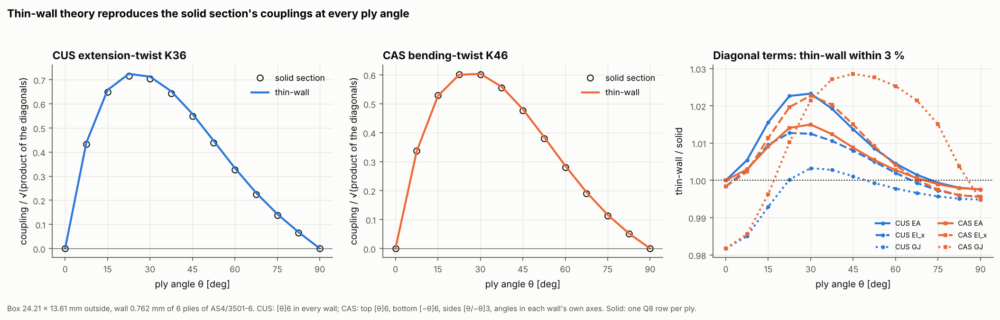
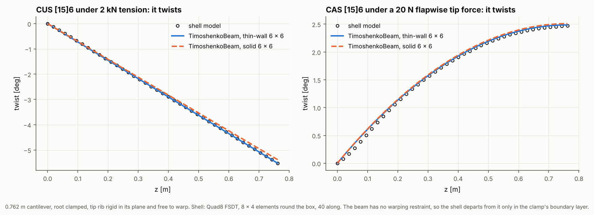

# 09 · Coupled composite box beams: CUS and CAS

Wind a box beam's plies at an angle and it stops stretching, bending and twisting
independently. This example builds the two classic coupled boxes from the composite-beam
literature and computes their section stiffness two ways:
- thin-wall theory (`ThinWalledSection`);
- the solid section (`SolidSectionAnalysis`), with every ply meshed.

A shell model of a cantilever then checks that the couplings do to a real structure what
the 6 × 6 says they will.

```bash
python examples/09_composite_box_couplings/composite_box_couplings.py          # about 40 s
python examples/09_composite_box_couplings/composite_box_couplings.py --reuse  # redraw and re-check
```



## The physics

A laminate whose plies are not balanced (+θ without a matching −θ) shears when it is
stretched: its A₁₆ is not zero. Put such walls round a box and the shear in each wall
adds up to something the beam feels. What it feels depends on how the walls are arranged
round the contour.

- **CUS** (circumferentially uniform stiffness): every wall is [θ]₆ in its own axes. Go
  round the box and the fibres form one continuous helix. Pulling the box makes every wall
  shear the same way round the contour, and a shear flow running round a closed section
  is a twist. The result is **extension-twist** coupling, K₃₆ in BeamDyn's order
  `[Fx, Fy, N, Mx, My, T]`. A CUS box also couples each transverse shear force with the
  bending about the same axis (K₁₄, K₂₅).
- **CAS** (circumferentially asymmetric stiffness): the top wall is [θ]₆ and the bottom
  wall is [−θ]₆ in their own axes. Because the two walls face opposite ways, their fibres
  point the same way when seen from outside the beam. Flap bending stretches one and
  compresses the other, so they shear in opposite senses, which again runs round the
  contour as a twist. The result is **bending-twist** coupling, K₄₆. This is the coupling
  a wind turbine blade is tailored with, so that it twists to shed load as it bends. A
  CAS box also couples extension with shear (K₁₃).

Both couplings are zero at 0° and 90°, where the walls are orthotropic in the beam axes.
They peak between about 20° and 30°. Changing θ to −θ reverses their sign. The script
checks that, which shows the ply angle convention comes through the model consistently
rather than being fitted to an answer.

The box is the size of Chandra et al.'s (1990) test specimens: 24.21 × 13.61 mm outside,
a 0.762 mm wall of six plies, and θ = 15°. The material is the library's AS4/3501-6, not
the specimens' measured properties. The comparisons here are therefore between models of
the same box, not with those tests.

## Thin-wall against the solid section

The solid section meshes every ply, with one Q8 row per ply, and needs no thin-wall
assumption. It is the reference here. It is converged: doubling the mesh changes K₃₆ by
0.06 % and K₄₆ by 0.05 %.

| θ = 15° | coupling, thin-wall | coupling, solid | largest diagonal difference |
| --- | --- | --- | --- |
| CUS K₃₆ / √(K₃₃K₆₆) | +0.657 | +0.650 | 2.4 % (EI_y) |
| CAS K₄₆ / √(K₄₄K₆₆) | +0.527 | +0.529 | 1.5 % (EI_y) |

Across all angles (figure, right) thin-wall theory stays within 3 % of the solid section
on every diagonal term. The wall here is t/h = 6 % of the box depth, so thin-wall theory
puts the plies on the mid-line a little too far out (example 08, right panel).

## What the couplings do: a shell cantilever



The cantilever is the same box, 0.762 m long, modelled with Quad8 FSDT shells (shell-fem)
and clamped at the root. A tip rib holds the section's shape and leaves it free to warp
and stretch.

- **CUS under 2 kN tension** twists by −5.52° at the tip. `TimoshenkoBeam` on the
  thin-wall 6 × 6 gives −5.53°, a 0.05 % difference. The twist rate is constant, because
  the axial force is. An uncoupled box would not twist at all.
- **CAS under a 20 N flapwise tip force** twists by 2.47° at the tip, against 2.49° from
  the beam (0.7 %). The twist rate follows the bending moment, which falls to zero at the
  tip, so the twist curve flattens there.

The shell falls slightly below the beam near the root. That is the clamp stopping the
section from warping, which the 6 × 6 beam does not model (example 10 does).

## Using it

```python
from _shared import composite_box as box     # this example's box builders

s = box.thin(lib, box.cus(15.0))              # ThinWalledSection
K = s.timoshenko_stiffness((0.0, 0.0))        # BeamDyn order [Fx, Fy, N, Mx, My, T]
K[2, 5] / np.sqrt(K[2, 2] * K[5, 5])          # extension-twist

from anisotropic_section_model import SolidSection
Ks = SolidSection(box.solid(lib, box.cus(15.0))).timoshenko_stiffness()   # same order

TimoshenkoBeam(K, 0.762).clamp(0.0).add_force(0.762, [0, 0, 2e3, 0, 0, 0]).solve().displacement(z)
```

Ply angles are measured from the beam axis, about the wall normal z × s. For a
counter-clockwise wall loop that normal points into the box. shell-fem's box elements
have outward normals, so `box.shell` converts the angles to them. A check confirms that
`ThinWalledSection.from_blade_mesh` of the shell gives exactly the section `box.thin`
builds.

## Checks

The script runs 24 checks:
- the couplings and every diagonal against the solid section (3 %);
- the sign flip (exact);
- the solid section's mesh convergence (0.2 %);
- the cantilevers' tip twist against the shell (2 %);
- that the shell's own section is the thin-wall one.
