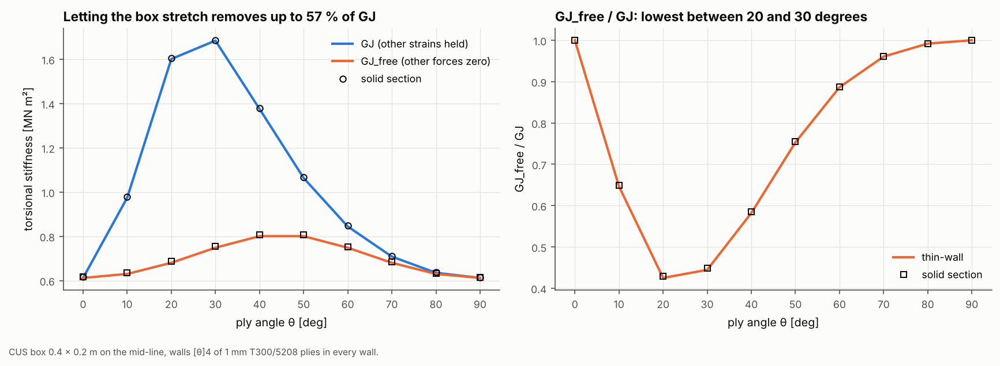
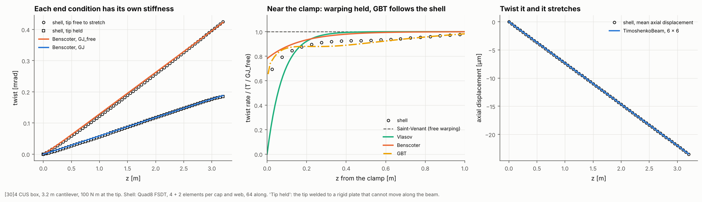

# 10 · Coupled torsion: GJ, GJ_free and restrained warping

A box whose walls all wind the same way round it (CUS, example 09) stretches when it is
twisted. That leaves two different torsional stiffnesses, and which one applies depends
on how the beam is held. This example shows both and checks each against a shell model.
It then looks at the clamp, where the section is also stopped from warping.

```bash
python examples/10_coupled_torsion/coupled_torsion.py          # about 15 s
python examples/10_coupled_torsion/coupled_torsion.py --reuse  # redraw and re-check
```



## The physics

The section stiffness links the six section strains to the six section forces. For a CUS
box the twist rate κ_z and the axial strain ε are coupled through K₃₆. There are then two
ways to define "torsional stiffness":

- **GJ = K₆₆**, the torque per unit twist rate **with every other strain held at zero**.
  The box is not allowed to stretch, so an axial force builds up to stop it.
- **GJ_free = 1 / C₆₆**, where C = K⁻¹ is the compliance. This is the torque per unit
  twist rate **with every other section force zero**. The box stretches freely, and its
  coupling softens the twist. For extension-twist alone this is GJ_free = K₆₆ − K₃₆²/K₃₃.

For a [30]₄ carbon box GJ_free = 0.44 GJ. Across ply angles the gap is largest between
20° and 30°, where the coupling peaks, and the two are equal at 0° and 90°.

`ThinWalledSection.GJ` is the first and `GJ_free` the second.
`RestrainedTorsionBeam.from_section` uses **GJ_free by default** (`other_strains="free"`),
since that is what a free cantilever feels. `other_strains="held"` gives GJ.

**Restrained warping.** Near a clamp the section cannot warp. The warping stiffness EΓ
then carries part of the torque, so the twist rate there falls below the Saint-Venant
value (example 01). This box also has a second root effect. The clamp stops the box
stretching as well, so near the root it behaves partly like the "held" box. The extra
axial stress this creates spreads into the walls through shear lag, over a longer length
than the warping decay length.

## A shell cantilever twisted two ways

The shell model is the [30]₄ box, 0.4 × 0.2 m on the mid-line, as a 3.2 m Quad8 shell
cantilever with 100 N m at the tip. The tip is held in one of two ways:

- **Free tip:** a rib holds the section's shape but leaves it free to warp and stretch.
- **Held tip:** a rigid plate stops it moving along the beam.



| | shell | beam | difference |
| --- | --- | --- | --- |
| Free tip: tip twist | 0.4249 mrad | Benscoter with GJ_free: 0.4226 | 0.5 % |
| Free tip: mid-span twist rate | 1.354e-4 rad/m | T / GJ_free = 1.336e-4 | 1.4 % |
| Held tip: tip twist | 0.1848 mrad | Benscoter with GJ: 0.1879 | 1.7 % |
| Held tip: mid-span twist rate | 6.06e-5 rad/m | T / GJ = 5.94e-5 | 2.2 % |
| Free tip: stretch under torque | −23.50 µm | `TimoshenkoBeam` on the 6 × 6: −23.45 µm | 0.2 % |
| Free tip: tip twist | 0.4249 mrad | GBT: 0.4268 | 0.5 % |

Using GJ for the free cantilever would read 2.2 times too stiff, and using GJ_free for
the held one 2.2 times too soft. Neither value is "the" torsional stiffness: it depends on
the boundary conditions.

**Near the clamp** (middle panel) the shell's twist rate drops to about 0.7 of
T / GJ_free.
- Vlasov forces the warping to zero exactly at the clamp, so its twist rate starts at
  zero. That is too stiff for a closed box, whose walls shear as they warp.
- Benscoter lets the warping shear. It gets the right level at the clamp and recovers
  over the warping decay length (0.16 m).
- The shell then stays a few percent below the free twist rate out to about 0.8 m. This
  is the clamp also holding the stretch, spread out by shear lag.

`GeneralizedBeam` (GBT) has the walls' own warping modes, so it follows that slow
recovery, which a one-mode torsion theory cannot. The clamp's region is local: from
mid-span outwards every model agrees with the shell.

## Using it

```python
s = ThinWalledSection.from_blade_mesh(box, z=L)    # or from_segments / from_geometry
s.GJ, s.GJ_free                                     # held, free

RestrainedTorsionBeam.from_section(s, L)                         # GJ_free (default)
RestrainedTorsionBeam.from_section(s, L, other_strains="held")   # GJ
r = beam.cantilever_tip_torque(T, z, tip_warping="free")         # or "restrained"

g = GeneralizedBeam(s, L, warping="full", distortional_modes=None).clamp(0.0).diaphragm(L)
g.add_torque(L, T); g.solve().mean_twist(z)
```

## Checks

The script runs 12 checks:
- GJ_free / GJ = 0.444 at 30° (the value PR 22 reported);
- GJ and GJ_free against the solid section (3 %);
- GJ_free = GJ at 0° and 90°;
- the shell's twist rate and tip twist for both tip conditions, its stretch, and GBT's
  tip twist (2 to 3 %);
- that the clamp stiffens the twist.
