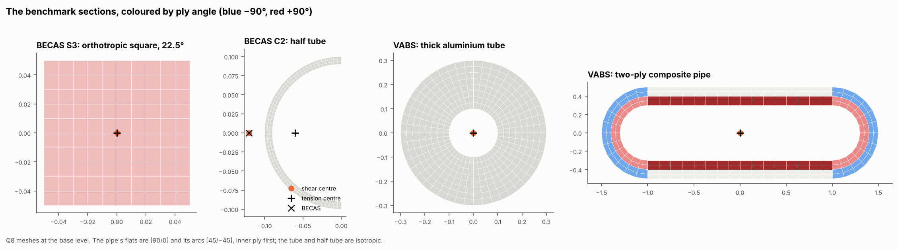
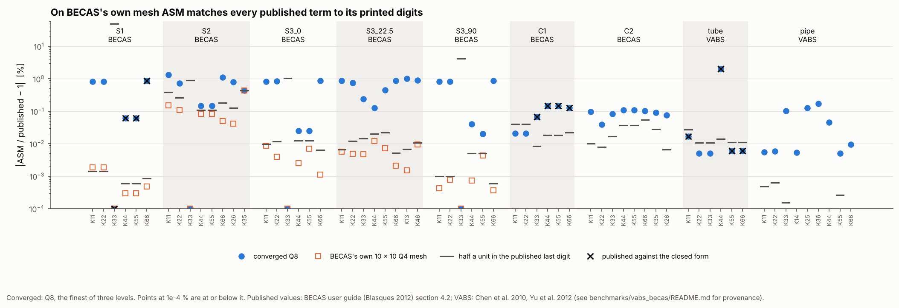
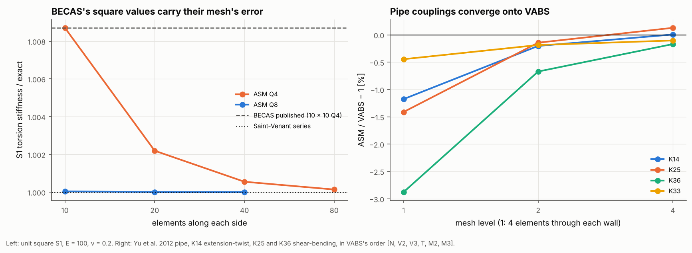

# 11 · Solid sections against BECAS and VABS

BECAS and VABS are the two established tools for the cross-section stiffness of
composite beams. Both solve the section's 2D elasticity problem by finite elements. The
package's `SolidSectionAnalysis` uses the same method (Giavotto's, as BECAS implements
it).

This example runs it on every section the two tools publish validation results for, and
compares term by term, couplings included:
- squares with one material, two materials and orthotropic plies;
- a tube and a half tube;
- a thick aluminium tube;
- a two-ply composite pipe with extension-twist and shear-bending couplings.

The cases, published values and their provenance live in
[`benchmarks/vabs_becas`](../../benchmarks/vabs_becas/). This example draws them and checks
them.

```bash
python examples/11_solid_sections_vs_becas_vabs/solid_sections_vs_becas_vabs.py          # about 1 min
python examples/11_solid_sections_vs_becas_vabs/solid_sections_vs_becas_vabs.py --reuse  # redraw and re-check
```



## The physics

A beam section's 6 × 6 stiffness comes from the section's warping, which has three
parts:
- **Axial warping** (out of the plane). Shear and torsion make the section warp out of
  its plane, as in Saint-Venant torsion.
- **In-plane deformation**. Poisson's ratio makes the section contract under extension
  and bending.
- **Anisotropy**. In an off-axis ply, extension also produces shear.

Thin-wall theory (examples 08 to 10) assumes the shape of these fields through each wall.
A solid analysis computes all three components everywhere in the section by finite
elements, so it holds for thick and solid sections, and for plies that change through a
wall. The price is a 2D mesh instead of a list of walls.

The cases test this progressively:

- **S1**, an isotropic square, has the exact Saint-Venant torsion constant (a series)
  and, from the elasticity solution, its shear stiffness.
- **S2** joins two materials with a 10:1 stiffness ratio across the middle. The tension
  centre moves towards the stiff side, which couples bending with extension (K₃₅) and
  shear with torsion (K₂₆).
- **S3** is an orthotropic square at 0°, 22.5° and 90°. At 22.5° the ply's own
  anisotropy couples shear with extension (K₁₃) and bending with torsion (K₄₆).
- **C1 and C2** are a thin tube and half of it. The open half tube's shear centre lies
  outside it, at −0.1206 (example 08's slit-tube effect, here in a thick wall).
- **Chen et al.'s aluminium tube** has a wall one third of its diameter: no thin-wall
  theory applies.
- **Yu et al.'s pipe** has flat walls of [90/0] and half-circle ends of [45/−45], which
  give extension-twist (K₁₄) and two shear-bending couplings (K₂₅, K₃₆).

## Results



**On BECAS's own mesh, ASM matches BECAS to its printed digits.** The BECAS user guide
gives its squares on a 10 × 10 bilinear (Q4) mesh. On that same mesh ASM reproduces every
term (orange squares) within half a unit in the last printed digit (grey bars), including
the 22.5° couplings. The two programs solve the same equations.

**Converged, ASM matches the exact solutions** (black crosses mark where a closed form
exists): the S1 torsion constant and the tubes' EA, EI and GJ to 1e-5 or better.

**Two published values carry known errors.**
- The squares' shear and torsion values sit 0.8 to 1.3 % above the converged solution.
  The left panel below shows why. BECAS's coarse bilinear mesh is too stiff. Refine
  that same element and it converges onto the exact value at second order. The quadratic
  Q8 is already there at 10 × 10.
- VABS's GJ for the thick aluminium tube is 2.0 % above the exact π G (r_o⁴ − r_i⁴)/2,
  while its other five terms agree with ASM and the closed forms to 0.02 %. ASM matches
  the exact value. This term is reported and checked against the closed form, not
  against VABS.

**On the composite pipe, every one of VABS's nine published terms agrees within 0.2 %**,
including the couplings (right panel). The couplings converge more slowly than the
diagonal terms because the stress is not smooth across the ply interfaces and the
flat-to-arc joints. They are the terms to watch when choosing a mesh for a real laminate.



## Using it

```python
from anisotropic_section_model.solid import SolidMaterial, SolidSectionAnalysis
from anisotropic_section_model.solid.structured import arc_patch, rectangle_patch, structured_mesh

mesh = structured_mesh([arc_patch((0, 0), r_in, r_out, 0.0, 2 * np.pi, 96, 4,
                                  lambda u, v: (1, 45.0 if v < 0.5 else -45.0))],   # (material, ply angle)
                       {1: SolidMaterial(E1, E2, E3, G12, G13, G23, nu12, nu13, nu23, rho)}, "Q8")
a = SolidSectionAnalysis(mesh)
a.stiffness, a.shear_centre, a.tension_centre, a.mass_properties
# 1d-fem order [eps, kappa_y, kappa_z, gamma_xy, gamma_xz, phi]: reorder for BECAS / VABS / BeamDyn
```

Meshes can also come from Gmsh (`SectionMesh.from_gmsh`), from a thin-walled section's
walls (`SectionMesh.from_thin_walled`), or from the implicit geometry
(`solid.from_geometry`, the solid comparison of `solid.compare_cut`).

## Provenance

The published values were taken from GXBeam's test suite, which cites these sources,
because the primary PDFs could not be read in full when the benchmark was built. The
pipe was cross-checked against the PreVABS documentation. The details, and the one
misprint in the BECAS material table, are in
[`benchmarks/vabs_becas/README.md`](../../benchmarks/vabs_becas/README.md). Check S2, C1
and C2 against the BECAS user guide's tables before quoting them.

## Checks

The script runs 114 checks:
- every published term against converged Q8: 1.5 % for the squares, which carry BECAS's
  mesh error; 0.2 % for C1 and C2; 0.05 % for the aluminium tube; 0.3 % for the pipe;
- the squares on BECAS's own Q4 mesh, against the printed digits;
- the closed forms, to 1e-5;
- the C2 centres;
- the second-order convergence of the bilinear mesh.

`tests/test_benchmark_vabs_becas.py` gates the same cases on faster meshes in the test
suite.
