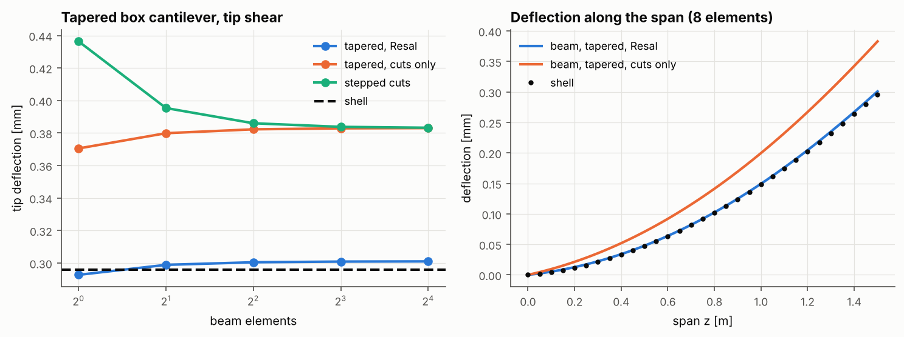
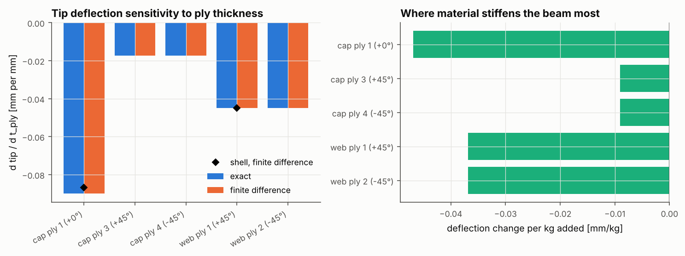

# 12 · Tapered beams and ply-thickness sensitivities

A carbon/glass box spar whose depth halves from root to tip, as a cantilever with a tip
shear force. This example does two things with it. First it shows what a beam model has
to add to its cross-sections to behave like the tapered beam: the Resal coupling, and
elements whose stiffness varies along them. Then it differentiates the tip deflection
exactly with respect to every ply's thickness, the gradient a layup optimiser needs.

```bash
python examples/12_tapered_beams_layup_sensitivities/tapered_beams_layup_sensitivities.py          # about 45 s
python examples/12_tapered_beams_layup_sensitivities/tapered_beams_layup_sensitivities.py --reuse  # redraw and re-check
```



## The beam

The box is 0.4 m wide and 0.3 m deep at the root and 0.15 m at the tip, on its wall
mid-lines, and 1.5 m long. The caps are T300/5208 [0₂/±45]ₛ and the webs E-glass/epoxy
[±45]ₛ, with 0.5 mm plies. The root is clamped and 1 kN acts along the depth on a tip rib.
The shell model is a Quad8 FSDT mesh of the four walls, whose depth varies linearly so
every wall stays planar.

## The physics: the Resal effect

A beam model of a tapered blade is usually built from cuts: the section is cut at a few
stations, each cut gives a 6 × 6, and the beam interpolates between them. Each cut is the
section of a prismatic beam of that shape. In a tapered beam the walls are not parallel
to the axis. The caps here slope towards each other, so the axial force each one carries,
±M/h, has a component across the beam. Together those components take part of the shear
force, and the webs carry only

V_web = V − M h′/h

(the Resal effect, in any tapered-beam text). At the root of this beam M h′/h is half of V, so
the webs carry half the shear force a cut would give them, and the beam deflects much
less in shear.

`thin_walled.taper.section_taper` gives this as a coupling between the section's shear
strains and its extension and bending: the energy of the inclined fibres stretched by the
shear strains (`SectionTaper`, added to the section's 6 × 6). For a box tapering in depth
the coupling is (h′/h) EI_y between κ_y and γ_xz, and the classical web shear above follows
from it exactly. `solid.taper.solid_section_taper` is the same for a section meshed in 2D.

The cuts also vary along the beam. `TimoshenkoBeam` now takes one 6 × 6 per node (or a
function of z) and integrates the compliance as it varies along each element, instead of
using one cut per element. Its elements stay exact for the stiffness they are given.

| Tip deflection under 1 kN | mm | against the shell |
| --- | --- | --- |
| shell | 0.2961 | |
| tapered beam with the Resal coupling, 8 elements | 0.3009 | +1.6 % |
| tapered beam, cuts only, 8 elements | 0.3829 | +29 % |
| stepped beam (one cut per element), 16 elements | 0.3832 | +29 % |
| tapered beam, Euler-Bernoulli | 0.2024 | −32 % |
| prismatic beam of the root section, against its own shell | 0.2738 vs 0.2690 | +1.8 % |

With the coupling, the tapered beam is as close to its shell as the prismatic beam is to
its own (1.6 % against 1.8 %; the rest is the clamp's shear lag). Without it the beam is
29 % too soft, and no refinement fixes that: the stepped beam converges to the cuts-only
value. The tapered elements converge with few elements because they integrate the varying
stiffness; the stepped beam needs many more for the same result.

## Ply-thickness sensitivities



For layup sizing, the derivative of the tip deflection with respect to each ply's
thickness comes out exactly, through three steps:

1. **The section.** `section_derivative(an, LayupParameter(laminate, ply, "thickness"), taper=taper)`
   differentiates the laminate, the wall law, the Saint-Venant solution, the mass and the
   taper coupling. The wall mid-lines stay put and each stack stays centred on its
   mid-line, as in the shell model.
2. **The beam.** `BeamSolution.displacement_derivative(dK)` takes the stiffness
   derivative at the nodes and differentiates each element's flexibility
   (dC = −C dK C) and the solve.
3. **The cost.** The section mass derivative gives the kilograms each ply adds, so the
   sensitivity per kilogram ranks where material is best spent.

| Ply | d tip / d t (mm per mm) | per kg added (mm/kg) |
| --- | --- | --- |
| cap ply 1 (0°) | −0.0900 | −0.047 |
| cap plies 3, 4 (±45°) | −0.0173 | −0.009 |
| web plies 1, 2 (±45°) | −0.0448 | −0.037 |

Each one matches a central difference of the whole chain to 2e-6, and a 10 % thicker ply
re-solved to within 0.04 % of the linear prediction. The two plies also checked against
the shell model's own finite differences agree within 3.8 % (cap) and 0.3 % (web). For
stiffness per kilogram, the caps' 0° plies are the place to add material here, the webs'
±45° plies next, and the caps' ±45° plies a distant third.

**Sections meshed in 2D.** `solid_section_derivative` now takes ply thicknesses as well
as angles. A thicker ply moves the nodes of a `SectionMesh.from_thin_walled` mesh
(`SectionMesh.velocities`), and the derivative carries that through the element
Jacobians, the tie weights at wall junctions, the Saint-Venant and restrained-warping
solves, the second-order terms and the mass. At the root section the solid and thin-wall
rates of EA, EI and the mass from the cap plies agree within 1.4 %. The web plies' do not
(EI_y +26 %): in the 2D mesh a thicker web also lengthens the caps that run over it at the
butt-jointed corners, so material appears at the corners, the farthest point from the
bending axis. The mid-line model has no corners, and this is a real difference between the
two models, not an error of either derivative.

## Using it

```python
from anisotropic_section_model.beam import TimoshenkoBeam, from_section_order
from anisotropic_section_model.thin_walled.taper import section_taper
from anisotropic_section_model.thin_walled.layup_sensitivity import LayupParameter, section_derivative

taper = section_taper(cut_before, cut_after, laminates, step)          # Resal coupling at a station
K = from_section_order(analysis.stiffness + taper.matrix())             # into the beam's order
sol = TimoshenkoBeam(K_at_nodes, z_nodes=z).clamp(0.0).add_force(L, [0, P, 0]).solve()

d = section_derivative(analysis, LayupParameter(1, 0, "thickness"), taper=taper)
dK = from_section_order(d.stiffness + d.taper.matrix())                 # one per node
dU = sol.displacement_derivative(dK_at_nodes)                           # (n_nodes, 6)
```

## Checks

The script runs 28 checks:
- the shell converged (twice the elements, 0.2 %) and the prismatic beam against its shell (3 %);
- the tapered beam with the Resal coupling against the tapered shell (3 %), and the cuts
  alone more than 20 % off;
- the stepped and tapered elements converged (0.2 %);
- each ply sensitivity against a central difference of the whole chain (1e-5) and the
  linear prediction of a 10 % thicker ply (0.2 %);
- two ply sensitivities against the shell's finite differences (8 %);
- the root section's solid against thin-wall thickness rates for the cap plies (3 %, mass 1 %),
  and the web plies' corner effect.
