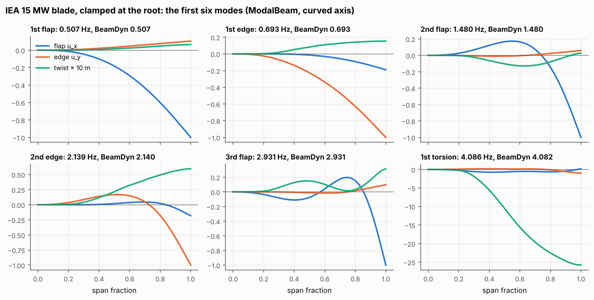
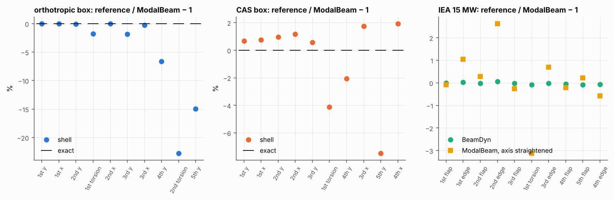
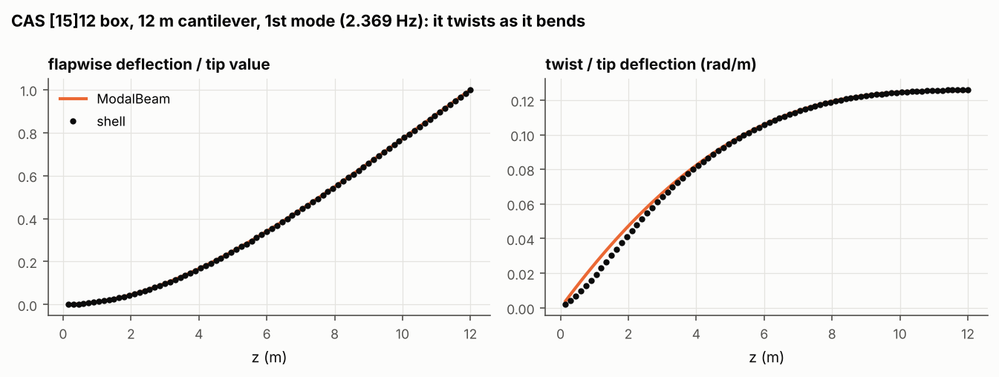

# 13 · Beam and blade modal analysis

A section's 6 × 6 stiffness and 6 × 6 mass are all a beam needs to vibrate. `ModalBeam`
takes them at stations along a span, with every coupling, turns each station by its
twist, follows a curved reference axis, and returns the natural frequencies and the mode
shapes. This example checks it against an exact solution, a shell model and BeamDyn.

```bash
python examples/13_beam_modal_analysis/beam_modal_analysis.py          # about 30 s
python examples/13_beam_modal_analysis/beam_modal_analysis.py --reuse  # redraw and re-check
BEAMDYN_DRIVER=/path/to/beamdyn_driver python examples/13_beam_modal_analysis/beam_modal_analysis.py  # + BeamDyn, 6 min
```



## The model

The linearised geometrically exact beam, which is also what BeamDyn linearises. With u
and θ the displacement and small rotation of the reference axis x₀(s), the strains in
each station's frame Λ₀ are

γ = Λ₀ᵀ (u′ + x₀′ × θ),  κ = Λ₀ᵀ θ′

and the kinetic energy is ½ ∫ [u̇, θ̇]ᵀ M [u̇, θ̇] ds with the section mass matrix M
(offset mass centre, rotary inertia, product of inertia). Both 6 × 6 matrices are used in
full, so extension-twist, bend-twist and shear-bending couplings and the offsets of the
mass and elastic centres all shape the modes.

It is discretised with spectral elements of order 6 on Gauss-Lobatto-Legendre nodes
(BeamDyn's kind), cut at every station, support and point mass. The low modes are found
as the largest eigenvalues of M φ = μ K φ, which keeps them accurate even when the shear
stiffness is many orders above the bending stiffness.

`prismatic_frequencies` gives the exact answer for a prismatic beam. It integrates the
same 12 first-order equations (displacements, rotations, section forces and moments)
across the span with a matrix exponential, and finds the frequencies where the end
conditions can be met.

## 1 · A coupled box against the exact solution and the closed forms

The box is the spar of example 10 with twelve 1 mm T300/5208 plies (so the walls' own
panel modes lie above the beam modes), 0.4 × 0.2 m, as a 12 m cantilever. Two layups:
**orthotropic** ([0]₁₂ in every wall) and **CAS** [15]₁₂ (top and bottom wound the same
way seen from outside), which couples flapwise bending with twist (example 09).

- The elements match `prismatic_frequencies` to better than 1e-8 on all ten modes of both
  boxes, couplings included.
- Torsion of the orthotropic box matches (1/4L)√(GJ/i_p) exactly.
- Bending sits 1.4 % below Euler-Bernoulli: carbon's E/G is about 25, so shear
  deflection is not small even at L/b = 30. With the shear stiffness raised and the
  rotary inertia lowered by 100, the elements reach the Euler-Bernoulli closed form
  (βL = 1.875, 4.694) within 1e-4 and 1e-3.
- The CAS box's first flapwise mode is 19 % below Euler-Bernoulli on its K₄₄: the
  bend-twist coupling softens it.

## 2 · The same boxes as shell models

The two boxes as Quad8 FSDT shell cantilevers in shell-fem (80 elements along the span,
8 across each cap, 4 down each web), with shell-fem's stiffness and a consistent shell
mass matrix. Shell modes are matched to beam modes by MAC on each ring's mean translation
and twist.



| | ModalBeam | shell | difference | MAC |
| --- | --- | --- | --- | --- |
| orthotropic, 1st flapwise | 3.4615 Hz | 3.4622 Hz | 0.02 % | 1.0000 |
| orthotropic, 1st chordwise | 5.9373 Hz | 5.9376 Hz | 0.01 % | 1.0000 |
| orthotropic, 2nd flapwise | 20.158 Hz | 20.138 Hz | 0.1 % | 1.0000 |
| orthotropic, 1st torsion | 33.756 Hz | 33.158 Hz | −1.8 % | 0.9999 |
| CAS, 1st flapwise | 2.3685 Hz | 2.3843 Hz | 0.7 % | 1.0000 |
| CAS, 1st chordwise | 4.8060 Hz | 4.8423 Hz | 0.8 % | 1.0000 |
| CAS, 2nd flapwise | 14.541 Hz | 14.680 Hz | 1.0 % | 0.9999 |
| CAS, 1st torsion | 50.397 Hz | 48.319 Hz | −4.1 % | 0.9999 |



The CAS box's first mode twists as it bends: 0.1255 rad of tip twist per metre of tip
deflection in the beam, 0.1261 in the shell (0.5 %). The beam's twist runs a little
ahead of the shell's near the root, where the clamp also stops the walls warping.

Where the shell departs from the beam it is for reasons a beam model cannot hold:

- **Torsion and the higher modes are lower in the shell.** Nothing holds the box's
  shape, so its cross-section distorts as it twists and as it bends in the higher
  modes, where the wavelength approaches a few widths. The orthotropic box's 2nd torsion
  mode is 23 % lower. Ribs would stop it, but rigid ribs also stop the walls' Poisson
  contraction and stiffen bending by 2 to 4 %, so this comparison leaves them out.
- **The CAS box's bending is about 1 % stiffer in the shell.** The clamp holds the
  coupled twist and warping at the root, which a 6 × 6 cannot know about.

## 3 · The IEA 15 MW blade against BeamDyn

The official IEA 15 MW BeamDyn deck (downloaded from the IEA-15-240-RWT repository at a
fixed commit, Apache-2.0, into `data/reference/`, which is git-ignored), read with
`BeamDynBlade.read` and turned into a `ModalBeam` by `from_beamdyn`: 26 stations along
117 m, twisted, prebent by 4 m, root clamped.

The reference is BeamDyn itself (OpenFAST 4.1.2's `beamdyn_driver`): a dynamic run from
rest under a small constant tip force in both directions and a tip torque, with no
damping (rhoinf = 1), 7 members of order 8 and Gauss quadrature, 60 s at 2 ms. Each
mode's frequency is found from the tip motion by a fit of sinusoids to the record.
Without `BEAMDYN_DRIVER` the example uses the BeamDyn frequencies committed in
`data/results.json`.

| mode | ModalBeam | BeamDyn | difference | axis straightened |
| --- | --- | --- | --- | --- |
| 1st flap | 0.5065 Hz | 0.5065 Hz | 0.00 % | −0.1 % |
| 1st edge | 0.6929 Hz | 0.6931 Hz | 0.02 % | +1.1 % |
| 2nd flap | 1.4801 Hz | 1.4797 Hz | −0.02 % | +0.3 % |
| 2nd edge | 2.1389 Hz | 2.1402 Hz | 0.06 % | +2.6 % |
| 3rd flap | 2.9314 Hz | 2.9310 Hz | −0.01 % | −0.3 % |
| 1st torsion | 4.0856 Hz | 4.0825 Hz | −0.08 % | −3.1 % |
| 3rd edge | 4.3748 Hz | 4.3742 Hz | −0.01 % | +0.7 % |
| 4th flap | 4.8398 Hz | 4.8375 Hz | −0.05 % | −0.2 % |
| 5th flap | 6.7866 Hz | 6.7811 Hz | −0.08 % | +0.2 % |
| 4th edge | 7.5186 Hz | 7.5141 Hz | −0.06 % | −0.6 % |

All ten modes agree within 0.1 %. The prebend matters: with the axis straightened the
2nd edge mode moves up 2.6 % and the 1st torsion mode down 3.1 %, because the curved axis
couples edgewise bending with twist.

The modes are those of the blade alone, clamped at the root and not rotating. A running
rotor adds centrifugal stiffening, which this model does not include yet.

## Using it

```python
from anisotropic_section_model import ModalBeam, BeamDynBlade, prismatic_frequencies

# a prismatic beam from one section
K6, M6 = section.timoshenko_stiffness(ref), section.mass_matrix(ref)
modes = ModalBeam.prismatic(K6, M6, 12.0).clamp(0.0).modes(10)
modes.frequencies, modes.labels(), modes.shape(0, z), modes.energy_fractions()

# a blade, from a BeamDyn deck or a BeamDynBlade swept from the geometry (example 07)
blade = ModalBeam.from_beamdyn(BeamDynBlade.read("IEA-15-240-RWT_BeamDyn.dat"))
blade.modes(10).table()

# any stations, frames, axis, supports and masses
ModalBeam(s, K_stations, M_stations, frame_angle=angles, axis=key_points).clamp(0.0).add_mass(30.0, 50.0)

prismatic_frequencies(K6, M6, 12.0, f_max=50.0, ends=("clamped", "free"))   # exact
```
