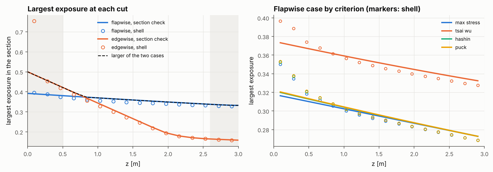
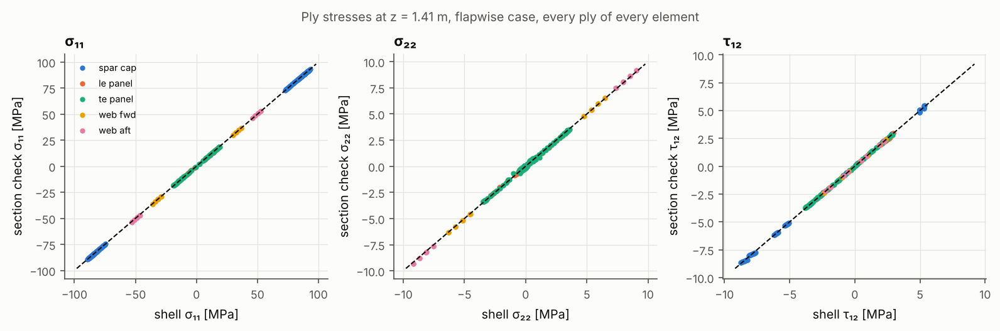
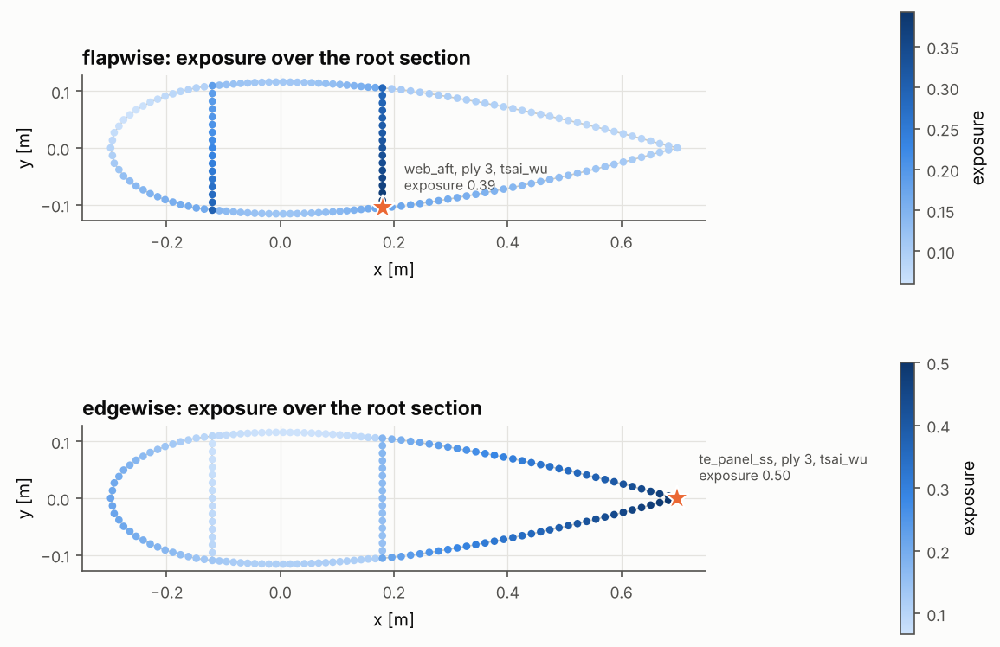

# 14 · Strength check of blade sections

A strength check runs in three steps: the section forces at a cut, the ply stresses those
forces put in every ply of the section, and the failure criteria on each ply. This example
runs the last two at every cut of a blade, with the forces from statics, and checks each
against a shell model of the same blade.

The section check is ASM's. Running it along a beam whose forces come from a beam solve,
with an envelope over load cases, is 1d-fem's (`ply_strength.txt`).

```bash
python examples/14_blade_section_strength/blade_section_strength.py          # about 1 min
python examples/14_blade_section_strength/blade_section_strength.py --reuse  # redraw and re-check
```



## The blade and the loads

The three-cell NACA 0024 blade of examples 02 and 05: 1 m chord, 3 m long, glass skins
[0/45/−45]s, carbon spar caps [0]₁₆, two glass shear webs [45/−45]s. It is clamped at the
root and loaded through a tip rib at the shear centre in two cases:

| Case | F_x (edgewise) | F_y (flapwise) | M_z (torque) |
|---|---:|---:|---:|
| flapwise | 3 kN | 30 kN | 4 kN m |
| edgewise | −40 kN | −6 kN | −3 kN m |

x points to the trailing edge and y to the suction side, as in every blade example. The ply
strengths are laminate-constitutive-model's library values for T300/5208 and E-glass/epoxy.

## The check

```python
from anisotropic_section_model import SectionStrength, ThinWalledSection

section = ThinWalledSection.from_blade_mesh(blade, z=1.5)
check = SectionStrength.from_thin_walled(section)          # strengths from the plies' materials
result = check.evaluate(cut_forces(z, tip, section.shear_centre))   # [Fx, Fy, N, Mx, My, Mz]
critical = result.critical()      # wall, ply, position, criterion, mode, exposure
```

1. **Section forces.** A cantilever is statically determinate, so `[Fx, Fy, N, Mx, My, Mz]`
   at every cut follow from the tip load by statics (`cut_forces` in the script). They would
   for a tapered blade too.
2. **Ply stresses.** `SectionStrength.from_thin_walled` takes the coupled Saint-Venant wall
   strains of the section (the same solution that gives its 6 × 6 stiffness), sets the
   released wall resultants to zero, and recovers the stress in every ply through each wall
   laminate, with the interlaminar stresses from 3D equilibrium. Here that is three points
   along each of the 88 walls and three heights in each ply: 6 624 points.
3. **Failure exposures.** Maximum stress, Tsai-Wu, Hashin and Puck (`ply_failure`) at every
   point. An exposure is the factor by which a proportional load is past (above 1) or short of
   (below 1) the failure surface, so the reserve factor is 1 / exposure.

Stresses are linear in the section forces. Each section is solved once for six unit forces,
and any number of cuts and load cases after that cost a matrix product and the criteria.
The section check knows nothing about the span, so any source of section forces works: a
beam solve in 1d-fem, or an aeroelastic run's section loads.

## Against the shell

The shell model is the blade in curved Quad8 FSDT elements on the skin mid-surface, 16
elements along the span, with the same tip rib. Its ply stresses come from shell-fem's exact
recovery at the centre of every element, at the middle of every ply. An element's centre lies
on a section point of `ThinWalledSection.from_blade_mesh`, so the two are compared at the
same points: 368 per element row.



At mid-span every in-plane ply stress (σ₁₁, σ₂₂, τ₁₂) in the caps, skins and webs agrees with
the shell within 3 % RMS of its largest value (0.1 to 0.5 % in the caps).

The left plot at the top compares the largest exposure in each element row. Away from the
clamp and the tip rib (the unshaded band) the section check is within 2.2 % of the shell for
every criterion, and both pick the same critical part and criterion at every row: the aft web
under the flapwise load, the trailing-edge skin under the edgewise load. Both name the root
as the critical cut. Near the tip the two middle −45° plies of the skin trade places as
the critical ply, at exposures 0.1 % apart.

At the root the shell sees more than Saint-Venant: the clamp stops the section warping and
contracting. The flapwise case's root row is 6 % above the section check. The edgewise case's
is 60 % above it, at the sharp trailing edge, where the clamp holds the thin skins against
the in-plane bending they would otherwise take. A check at a root or any other restraint
needs a model of that restraint: GBT (examples 04 and 05) or a local shell or solid model.



## Thin-walled against solid

`SectionStrength.from_solid` does the same on a section meshed in 2D
(`SolidSectionAnalysis`), with the 3D stresses at every quadrature point in ply axes. At
mid-span, away from the web-skin junctions, its critical exposure is within 1 % of the
thin-walled one in both cases, by the same criterion. At the junctions the solid strips
overlap, which the mid-line model does not see, and the flapwise case reads 15 % higher there.

## Checks

49 checks: the saved forces against statics; σ₁₁, σ₂₂ and τ₁₂ in each part against the
shell (RMS within 5 % of the part's largest value); every criterion's largest exposure at
the valid cuts within 5 % of the shell; the same critical part and criterion at every valid
row and the same ply at three quarters of them or more; the root as the critical cut; and
the solid section within 3 % of the thin-walled one away from the junctions.
