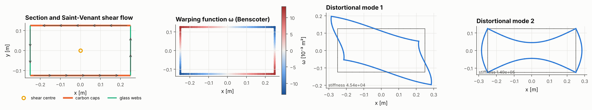
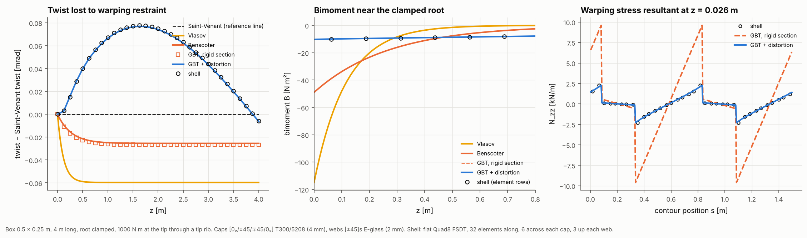
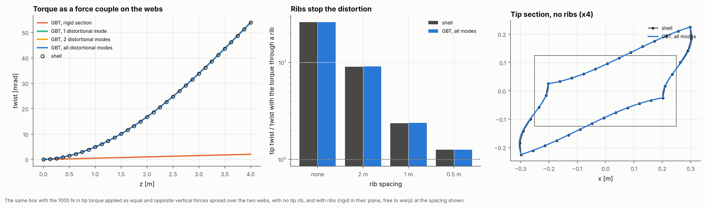

# 27 · Box spar torsion: Saint-Venant, restrained warping and distortion

A box spar, the load-carrying box of a blade or wing, is clamped at the root and
twisted at the tip. Three torsion theories are layered on top of each other. Each
layer is checked against its closed-form solution and against a shell model of the
same box:

1. **Saint-Venant.** The section warps freely and the torque is carried by the Bredt
   shear flow round the cell. The twist rate is T / GJ.
2. **Restrained warping.** The clamp stops the root section warping. That sets up a
   bimoment B and axial warping stresses, and part of the torque is carried as a
   warping torque dB/dz. Vlasov's theory ties the warping to the twist rate.
   Benscoter's gives the warping an amplitude of its own, with shear deformation,
   which a closed section needs.
3. **Distortion (GBT).** The box is not rigid in its plane. Generalised Beam Theory
   adds the section's distortional modes as beam degrees of freedom: the box racking
   into a rhombus, the caps bowing. Ribs (diaphragms) stop them.







## The API

```python
section = ThinWalledSection.from_blade_mesh(box, z=4.0)     # or from_segments / points + walls
section.GJ, section.EGamma, section.shear_centre, section.omega, section.shear_flow

beam = RestrainedTorsionBeam.from_section(section, 4.0)         # Benscoter; vlasov=True for Vlasov
r = beam.cantilever_tip_torque(1e3)                             # closed form: twist, phi, B, T_sv, T_w
r = beam.solve(tip_torque=1e3, supports={0.0: (True, True)})    # FE: any supports, distributed torque

z = GeneralizedBeam.graded_nodes(4.0, 32, stations=[1, 2, 3])   # element ends at the ribs
gbt = GeneralizedBeam(section, 4.0, warping="full", distortional_modes=None, z_nodes=z)
gbt.clamp(0.0).diaphragm(1.0).add_wall_load(4.0, gbt.walls_named("web_te"), (0, F))
sol = gbt.solve()
sol.mean_twist(z), sol.bimoment(z), sol.distortion(z, 0), sol.wall_resultants(z), sol.section_displacement(z)
```

`ThinWalledSection` solves the Saint-Venant warping on the wall network in one step:
the warping ω that minimises the shear strain energy ∑ Gt (r_n − dω/ds)². That gives
the Bredt shear flows for any number of cells and the sectorial coordinate on open
branches. The shear centre is the pole that makes ω orthogonal to bending, and the
warping constant is EΓ = ∫ Et ω² ds plus the walls' own bending. S = Ip − J is the
shear stiffness of the warping: S = ∞ is Vlasov's limit, and closed sections have a
small S.

`GeneralizedBeam` keeps the walls inextensible round the contour and gives every
section point an axial warping displacement and an in-plane displacement and rotation.
Each wall is a Kirchhoff plate strip that carries its full wall stiffness, couplings
included. The in-plane fields split into three rigid modes (x, y, and rotation about
the shear centre, whose amplitude is the twist) and the distortional modes. The
distortional modes are free of work with the Saint-Venant shear flows and ordered from
the softest. Choosing the modes gives the hierarchy: `warping="classical",
distortional_modes=0` is Benscoter's beam, and adding modes adds shear lag and then
distortion.

## The model

| Item | Value |
|---|---|
| Box | 0.5 × 0.25 m (wall mid-lines), 4 m long, root clamped |
| Caps | [0₂/45/−45/−45/45/0₂] T300/5208, 8 × 0.5 mm |
| Webs | [±45]s E-glass, 4 × 0.5 mm |
| Shell | Flat Quad8 FSDT on the wall mid-surfaces: 32 along, 6 across each cap, 3 up each web |
| GBT | 32 elements, graded towards the clamp and the ribs; full warping and all 33 distortional modes unless stated |
| Loads | 1 kN m at the tip, either through a tip rib (rigid in its plane, free to warp) or as equal and opposite vertical forces on the two webs with no rib |
| Twist | The least-squares rotation of the section's nodes, measured the same way in the shell and GBT (an RBE3 reference node measures it the same way) |

```bash
python examples/27_box_spar_torsion/box_spar_torsion.py     # about 25 s
```

## Results

Section: GJ = 1.926 MN m² (the wall plate twisting adds 247 N m²), EΓ = 25.4 kN m⁴,
μ = 1 − J/Ip = 0.18, and the warping decays over 1/k = 0.27 m. The shear centre is at
the box centre.

**Torque through a tip rib** (tip twist, against the shell):

| Model | Tip twist [mrad] | Against the shell |
|---|---:|---:|
| Saint-Venant | 2.0766 | +0.28% |
| Vlasov | 2.0170 | −2.60% |
| Benscoter (closed form) | 2.0512 | −0.95% |
| GBT, rigid section | 2.0499 | −1.01% |
| GBT + distortion | 2.0704 | −0.02% |
| Shell | 2.0708 | |

| Root bimoment [N m²] | |
|---|---:|
| Vlasov | −114.9 |
| Benscoter | −49.0 |
| GBT, rigid section | −48.7 |
| GBT + distortion | −10.4 |
| Shell, first element row (z = 0.06 m) | −10.0 (GBT there −10.0) |

- The GBT beam with the section held rigid reproduces Benscoter's closed form (twist
  within 0.1%, root bimoment within 1%). Vlasov's theory overstates the bimoment
  more than twice over, because a closed section is not shear-rigid in warping.
- The shell sits on the GBT curve with distortion, not on Benscoter's. Even with the
  torque fed in as pure shear flow through a rib, the clamp's warping restraint is
  relieved by the box distorting near the root. That cuts the root bimoment and the
  warping stresses (right-hand panel) by a factor of five. Because of the distortion
  the least-squares twist rises above the Saint-Venant line over the first two metres
  and comes back at the rib.
- The warping stress resultant round the section at the first Gauss line matches the
  shell point for point once distortion is included.

**Torque as a force couple on the webs, no tip rib:**

| Ribs | Shell [mrad] | GBT, rigid | GBT, 1 mode | GBT, all modes |
|---|---:|---:|---:|---:|
| none | 53.89 | 2.05 | 53.86 | 53.83 |
| every 2 m | 18.74 | 2.05 | 19.03 | 18.91 |
| every 1 m | 4.91 | 2.05 | 4.99 | 4.95 |
| every 0.5 m | 2.62 | 2.05 | 2.63 | 2.62 |

- Without ribs, the same torque introduced as forces on the webs twists the tip 26
  times more than through a rib. Nearly all of it is the rhombic distortion of the box,
  and the first GBT mode captures it alone. The rigid-section theories miss it.
- Ribs bring the response back towards the rigid section. GBT tracks the shell to
  within 1% at every rib spacing.

## Notes

- The section properties are checked against textbook closed forms in
  `tests/test_torsion.py`: an isotropic box (Bredt GJ, ω at the corners, EΓ, Ip), an
  I-beam (open GJ, Γ = t b³ h²/24) and a channel (shear centre 3b²/(h + 6b), Γ).
- GBT keeps the walls inextensible round the contour, and its wall membrane carries no
  hoop stress. The shell has neither restriction. Both effects are small for thin walls.
- The section must be prismatic. Linear static analysis only.
