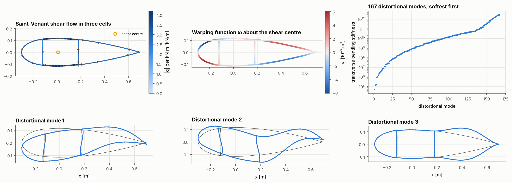
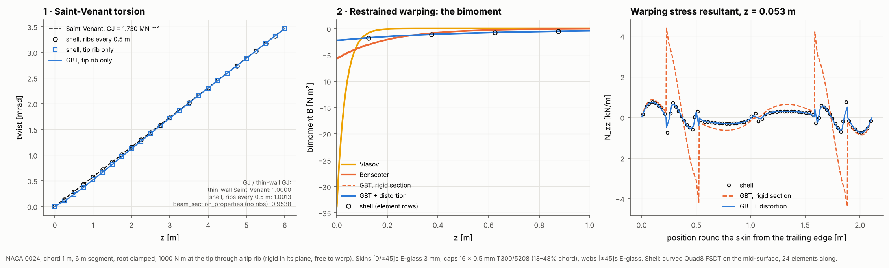
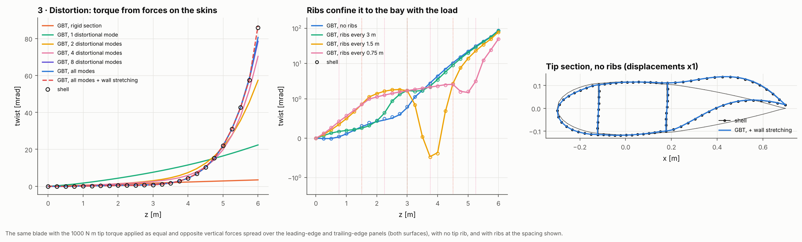

# 28 · Blade torsion, layer by layer: Saint-Venant, the bimoment and GBT distortion

A blade section twists in three ways at once. Saint-Venant shear flows circulate in
its cells. The section warps out of its plane, and where that warping is stopped (at
a clamp, a stiff rib, or a change of section) a bimoment builds up. And the cells
distort in their own plane. This example takes the three-cell section of example 20
and adds each contribution in turn. Each layer is checked against a shell model of
the same blade segment.







## The hierarchy

| Layer | Physics added | Model | API |
|---|---|---|---|
| 1 · Saint-Venant | Shear flows in every cell, free warping, GJ | Multi-cell Bredt-Batho plus wall twisting | `ThinWalledSection.GJ`, `.shear_flow` |
| 2 · Restrained warping | Warping function ω, warping constant EΓ, bimoment B, warping torque | Vlasov (warping tied to the twist rate) or Benscoter (its own amplitude, shear-deformable) | `RestrainedTorsionBeam`, `GeneralizedBeam(warping="classical", distortional_modes=0)` |
| 2b · Shear lag | Warping free at every section point | GBT, full warping | `GeneralizedBeam(warping="full", distortional_modes=0)` |
| 3 · Distortion | The cells' in-plane deformation, resisted by wall bending; ribs | GBT distortional modes, softest first | `GeneralizedBeam(distortional_modes=n)`, `.diaphragm(z)` |
| 3b · Wall stretching | Walls stretching round the contour (GBT transverse extension) | GBT with the full wall ABD | `GeneralizedBeam(extensible=True)` |

```python
blade = BladeBuilder(stations, regions, webs, n_span=24, mesh_surface="mid").build(laminates, FSDTModel())
section = ThinWalledSection.from_blade_mesh(blade, z=6.0)      # walls from the shell edges on that section

beam = RestrainedTorsionBeam.from_section(section, 6.0)
r = beam.cantilever_tip_torque(1e3)                             # twist, warping amplitude, bimoment, torque split

z = GeneralizedBeam.graded_nodes(6.0, 24, stations=ribs)
gbt = GeneralizedBeam(section, 6.0, warping="full", distortional_modes=None, z_nodes=z, extensible=True)
gbt.clamp(0.0)
for zr in ribs:
    gbt.diaphragm(zr)
gbt.add_wall_load(6.0, le_walls, (0, F)).add_wall_load(6.0, te_walls, (0, -F))
sol = gbt.solve()
```

## The model

| Item | Value |
|---|---|
| Section | NACA 0024, chord 1 m, pitch axis at 30% chord. LE panel 0–18%, spar caps 18–48%, TE panel 48–100% (sharp TE), webs at 18% and 48%: three cells |
| Laminates | Skins [0/45/−45/−45/45/0] E-glass (3 mm); caps 16 × 0.5 mm T300/5208 at 0°; webs [±45]s E-glass (2 mm) |
| Shell | Curved Quad8 FSDT on the skins' mid-surface, 24 elements along the 6 m segment; root clamped |
| Section for the beams | The 86 points and 88 walls on the shell's tip section (two walls per quadratic edge) |
| GBT | 24 elements graded towards the clamp and each rib; 86 warping DOFs; 167 distortional modes (inextensible) or 255 (extensible) |
| Loads | 1 kN m at the tip, (a) through a tip rib (rigid in its plane, free to warp) or (b) as +F on the leading-edge panels and −F on the trailing-edge panels (both surfaces), spread uniformly, with no tip rib |
| Ribs | Rigid in their plane, free to warp: RBE2 on the in-plane translations in the shell, a diaphragm in GBT |
| Twist | Least-squares rotation of the section's nodes, the same measure in both models |

```bash
python examples/28_blade_torsion_hierarchy/blade_torsion_hierarchy.py    # about 3 minutes
```

## Results

### 1 · Saint-Venant

| GJ [N m²] | | Against thin-wall |
|---|---:|---:|
| `ThinWalledSection` (Saint-Venant, free warping) | 1.730 × 10⁶ | |
| Shell with ribs every 0.5 m (no distortion), twist rate between 2 and 4 m | 1.732 × 10⁶ | +0.13% |
| `beam_section_properties` (6 m segment, no ribs) | 1.650 × 10⁶ | −4.6% |

The thin-wall Saint-Venant GJ and the shell agree once ribs keep the section in shape.
`beam_section_properties` reads 4.6% lower. That is not an error in either model: its
clamped root and rigid tip restrain warping, and the section distorts between them,
which the measured twist includes. The gap shrinks as the segment gets longer. Use the thin-wall GJ as the Saint-Venant value. The shear centre
sits 8 mm aft of the pitch axis.

### 2 · Restrained warping (tip torque through a tip rib)

| | Root bimoment [N m²] | Tip twist [mrad] |
|---|---:|---:|
| Saint-Venant | 0 | 3.4689 |
| Vlasov | −33.8 | 3.4493 |
| Benscoter | −5.75 | 3.4655 |
| GBT, rigid section | −5.52 | 3.4624 |
| GBT + distortion | −2.24 | 3.4654 |
| Shell | | 3.4624 |
| First element row (z = 0.125 m): shell / GBT + distortion | −1.79 / −1.75 | |

- The section is closed and stiff in shear, so warping restraint barely changes the
  twist (Benscoter μ = 0.03, decay length 0.2 m). It does create axial warping
  stresses at the root. Vlasov's theory, which treats warping as shear-rigid,
  overstates the bimoment six times over.
- Distortion relieves the restraint further. Near the clamp the cells shear and the
  bimoment drops to 40% of Benscoter's. The warping stress resultant round the skin
  (right-hand panel) follows the shell point for point with distortion included. The
  rigid-section model puts large spurious peaks at the spar-cap edges.

### 3 · Distortion (torque from forces on the skins, no tip rib)

| GBT level | Twist at z = 5 m [mrad] | Tip twist [mrad] |
|---|---:|---:|
| Rigid section | 2.89 | 3.46 |
| 1 distortional mode | 16.44 | 22.38 |
| 2 modes | 21.23 | 57.38 |
| 4 modes | 19.83 | 70.33 |
| 8 modes | 21.80 | 78.47 |
| All 167 modes | 21.94 | 80.59 |
| All modes + wall stretching | 22.06 | 86.98 |
| **Shell** | **22.05** | **85.80** |

| Ribs (no tip rib) | Shell, z = 5 m / tip | GBT + wall stretching, z = 5 m / tip |
|---|---:|---:|
| none | 22.05 / 85.80 | 22.06 / 86.98 |
| every 3 m | 20.37 / 83.91 | 20.41 / 85.08 |
| every 1.5 m | 14.06 / 77.41 | 14.03 / 78.45 |
| every 0.75 m | 1.62 / 49.26 | 1.52 / 50.00 |

- Put into the skins instead of through a rib, the same torque twists the tip 25
  times more. Almost all of that is the section distorting near the load: the
  trailing-edge cell shears and the panels bow (right-hand panel).
- The distortional modes converge in order. Eight modes give the twist 1 m from the
  load within about 1%. At the loaded section itself, the skins also stretch round the
  contour under the local loads. Adding that (the extensible walls) brings the tip
  within 1.4% of the shell. Classical inextensible GBT is 6% stiff there.
- Ribs confine the distortion to the bay that carries the load (middle panel, logarithmic
  above 1 mrad). The twist inboard of the last rib drops to the rigid-section line, but
  the unribbed tip bay still distorts. A rib at the load introduction is what stops it.

## Notes

- The section must be prismatic, as in examples 20 and 27. For a tapered blade, cut
  sections along the span and use them station by station.
- GBT and the shell differ in two assumptions: GBT's walls are Kirchhoff strips on
  straight facets between section points, and inextensible GBT carries no hoop
  stress. Section 3 shows where each matters.
- Linear static only. The large distortional rotations under the skin couple are
  for comparison between the models, not a physical load level.
