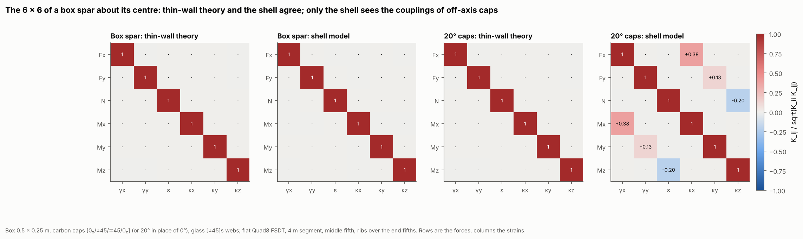
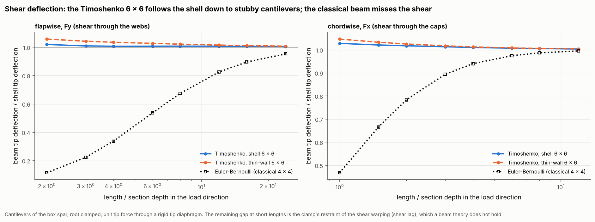
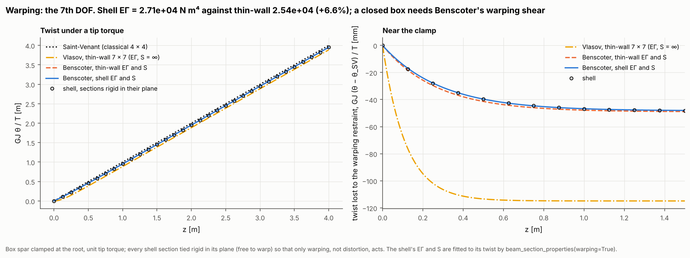
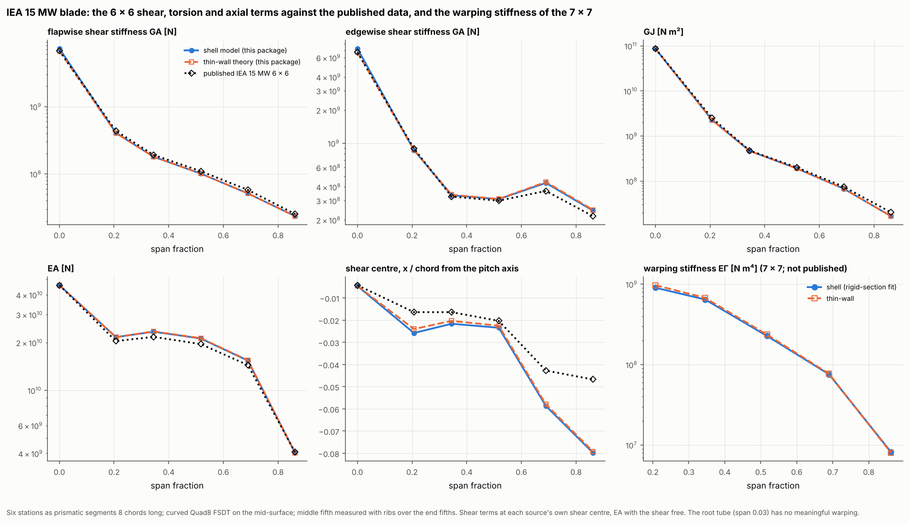
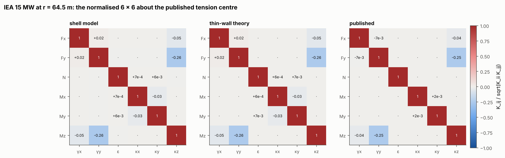

# 29 · Beam section stiffness: Timoshenko 6 × 6 and Timoshenko-Vlasov 7 × 7

The classical section stiffness of a blade is a 4 × 4: it relates the axial force and
the three moments [N, Mx, My, Mz] to extension, the two bending curvatures and the
twist rate. Two deformations that examples 27 and 28 showed to matter are not in it:

- **Transverse shear.** The Timoshenko 6 × 6 adds the two shear strains γx, γy and
  their forces Fx, Fy. It carries shear deflection and the coupling of shear with twist
  (the shear centre away from the reference) and with bending. It is what BeamDyn,
  HAWC2 and the windIO files use.
- **Restrained warping.** The Timoshenko-Vlasov 7 × 7 adds the warping DOF: the
  seventh strain is the gradient of the warping amplitude (κz′ in Vlasov's theory) and
  its force is the bimoment B, with EΓ on the diagonal. A closed section also needs
  Benscoter's warping shear stiffness S, which comes with it.

Each matrix is computed two ways that share no code: thin-wall section theory
(`ThinWalledSection.timoshenko_stiffness`, `vlasov_stiffness`) and the shell model
loaded as a cantilever (`beam_section_properties`). They are compared on a composite
box spar and on six stations of the IEA 15 MW blade, against the published 6 × 6.











## The API

```python
props = beam_section_properties(blade, end_ribs=0.2, warping=True)
props.stiffness_6x6      # Timoshenko, [Fx, Fy, N, Mx, My, Mz] against [γx, γy, ε, κx, κy, κz]
props.stiffness          # classical 4 × 4: the 6 × 6 with the shear forces free
props.stiffness_7x7      # with warping=True: adds κz′ / bimoment, EΓ on the diagonal
props.EGamma, props.warping_shear_stiffness, props.GA, props.shear_centre
props.at((x, y))         # the 6 × 6 about another point

section = ThinWalledSection.from_blade_mesh(blade)
section.timoshenko_stiffness(reference=(0, 0)), section.vlasov_stiffness(reference=(0, 0))
transform_beam_stiffness(K6, offset=(dx, dy), angle=0.0)
```

**Shell model.** The segment is clamped at the root and loaded through a rigid tip
diaphragm. Two RBE3 links measure the mean section motion at the ends of the middle
fifth. Axial force and moments are constant along a cantilever and give four columns of
the 6 × 6 compliance directly. A tip shear force also brings a bending moment that
grows towards the root; that part is subtracted, and the shear strain is the slope of
the axis minus the section rotation, averaged exactly over the middle fifth (with the
−L²θ″/12 correction to the trapezoidal mean, as the rotation is quadratic). Two
details decide the numbers:

- *The section rotation.* Shear warps a section, so it has no single rotation, and the
  shear stiffness depends on how it is defined. The RBE3 weights each node by its
  axial stiffness Et and its share of the contour, which gives the rotation that does
  work with the bending moment (as 2D section tools define it). Equal weights read the
  box spar's chordwise GA 12% stiffer.
- *End ribs.* The clamp and the rigid tip restrain warping, and with nothing to stop
  it the section distorts to relieve that restraint, over a length that reaches the
  middle of the span: the box spar's GJ reads 4.9% high and example 28's blade 2.4%
  low. `end_ribs=0.2` holds the sections over the end fifths rigid in their plane
  (free to warp), as ribs or bulkheads do; then GJ is the Saint-Venant value. It does
  not change EA or EI (0.02%).

With `warping=True`, one more run ties every section rigid in its plane (free to warp),
clamps the root and twists the tip. Benscoter's closed form for that cantilever is
fitted to the twist along the span (GJ, EΓ and S), so distortion does not enter.

**Thin-wall theory.** The axial and bending block is plane sections with each wall's
Et. The shear and torsion block comes from the shear flows: for a shear force the flow
that balances the axial stress gradient along each wall (quadratic in each wall) and
leaves free edges unloaded, plus the closed-cell flows. The cell flows and the twist
follow from minimum complementary energy with the torque in equilibrium (the walls' own
twisting carries the rest). The 7 × 7 adds EΓ with the warping function about the
shear centre, orthogonal to extension and bending, so the bimoment is uncoupled.

## The models

| Item | Value |
|---|---|
| Box spar | Example 27's box: 0.5 × 0.25 m wall mid-lines, carbon caps [0₂/45/−45/−45/45/0₂] (8 × 0.5 mm), glass webs [±45]s (4 × 0.5 mm); a variant with 20° in place of the caps' 0° plies |
| Box shell | Flat Quad8 FSDT, 6 across each cap, 3 up each web, 8 elements per metre along the span (12 at least); 4 m segment for the section stiffness |
| Cantilevers | 0.5 to 6 m, root clamped, unit tip force through a rigid tip diaphragm |
| IEA 15 MW | The six stations of example 24 as prismatic segments 8 chords long, curved Quad8 FSDT on the mid-surface (`mesh_surface="mid"`), chordwise size 1.5% of the perimeter, 32 along the span |
| Published data | The windIO `elastic_properties` 6 × 6 of the IEA 15 MW yaml, turned into the shell's axes |

The published axes are x flapwise and y chordwise aft, both from the pitch axis: a
mirror image of the shell's (x chordwise aft, y flapwise). The comparison swaps x and
y and, since moments are pseudo-vectors, flips their sign. With that, all three 6 × 6
have the same couplings with the same signs (last figure).

```bash
python examples/29_timoshenko_vlasov_stiffness/timoshenko_vlasov_stiffness.py           # about 20 minutes
python examples/29_timoshenko_vlasov_stiffness/timoshenko_vlasov_stiffness.py --reuse   # figures from data/results.json
```

## Results

### Box spar

| Term (about the box centre) | Shell | Thin-wall | Thin-wall against shell |
|---|---:|---:|---:|
| GA_x (chordwise shear, caps) [N] | 9.465 × 10⁷ | 9.160 × 10⁷ | −3.2% |
| GA_y (flapwise shear, webs) [N] | 9.948 × 10⁶ | 9.546 × 10⁶ | −4.0% |
| EA [N] | 4.284 × 10⁸ | 4.285 × 10⁸ | +0.02% |
| EI_x, EI_y [N m²] | 6.564, 9.450 × 10⁶ | 6.564, 9.450 × 10⁶ | 0.00% |
| GJ [N m²] | 1.937 × 10⁶ | 1.926 × 10⁶ | −0.6% |
| EΓ [N m⁴] (7 × 7) | 2.711 × 10⁴ | 2.543 × 10⁴ | −6.2% |
| Benscoter S [N m²] | 3.83 × 10⁵ | 4.29 × 10⁵ | +12% |

- Extension, bending and torsion agree to 0.6% or better. The shell's shear
  stiffnesses are 3–4% higher. `tests/test_beam_stiffness.py` runs the same box with
  Poisson's ratio set to zero, and then every term of the two 6 × 6 agrees within 0.5%.
  So the gap is Poisson's ratio: the Poisson strain of the bending stress varies along a
  beam in shear and stiffens it, as in Cowper's shear coefficient. Thin-wall shear flows
  leave that out.
- EΓ and S from the shell agree with thin-wall theory to 6% and 12%. Fitting them to
  a twist curve is less precise than reading a stiffness: in the test, refining the
  span mesh moves the fitted EΓ by 10% before it settles 3.5% below thin-wall theory.
- With the caps' 0° plies turned to 20°, the shell 6 × 6 shows extension-twist coupling
  (−0.20, both caps turn the same way, so the box twists as it stretches) and
  shear-bending coupling (+0.38 between γx and κx, +0.13 between γy and κy). Thin-wall
  theory, with uncoupled walls, has none. Couplings of off-axis walls come from the
  shell model.

**Shear deflection** (beam tip deflection over the shell's, tip force Fy through the
webs):

| L / depth | Timoshenko, shell 6 × 6 | Timoshenko, thin-wall 6 × 6 | Euler-Bernoulli 4 × 4 |
|---:|---:|---:|---:|
| 2 | 1.020 | 1.058 | 0.114 |
| 4 | 1.007 | 1.035 | 0.338 |
| 8 | 1.008 | 1.022 | 0.674 |
| 16 | 1.007 | 1.012 | 0.896 |
| 24 | 1.005 | 1.008 | 0.953 |

- The webs are soft in shear ([±45] glass), so the classical beam misses most of the
  deflection of a short cantilever, and 5% even at 24 depths long. Both 6 × 6 put
  the shear deflection back: the shell's within 2% at two depths long, thin-wall's
  within 6%.
- At short lengths the beams sit slightly above the shell: the clamp holds the root
  section flat and stiffens it against shear warping (shear lag), which a beam theory
  does not see. Under Fx (shear through the caps) the gap is 2.8% at one width long.

**Restrained warping** (sections rigid in their plane, root clamped, tip torque): the
shell's twist follows Benscoter's closed form with its own EΓ and S point for point,
and with the thin-wall EΓ and S within 1 mm of GJ θ / T near the clamp. Vlasov's theory
(the 7 × 7 with S = ∞) overstates the twist lost to the restraint more than twice, as
example 27 found: a closed box is not shear-rigid in warping.

### IEA 15 MW blade

Each source at its own shear centre (shear terms) and with the shear free (GJ, EA):
thin-wall and published values against the shell.

| r [m] | GA flap | | GA edge | | GJ | | EA | | EΓ (7 × 7) |
|---:|---:|---:|---:|---:|---:|---:|---:|---:|---:|
| | thin-wall | published | thin-wall | published | thin-wall | published | thin-wall | published | thin-wall |
| 4.0 | −7.3% | −7.3% | −7.3% | −7.4% | 0.0% | −0.1% | 0.0% | 0.0% | (tube) |
| 28.2 | −0.9% | +6.9% | +0.5% | +3.7% | 0.0% | +10.5% | +0.1% | −5.5% | +7.5% |
| 44.3 | 0.0% | +6.4% | +1.2% | −2.8% | +0.2% | +1.7% | +0.4% | −7.2% | +4.9% |
| 64.5 | 0.0% | +8.7% | +0.4% | −3.2% | +0.3% | +5.7% | +0.5% | −7.8% | +3.9% |
| 84.7 | +0.1% | +12.7% | +2.0% | −15.5% | +0.3% | +10.5% | +0.5% | −6.3% | +1.6% |
| 104.8 | −0.5% | +7.2% | +1.5% | −10.9% | +0.1% | +21.5% | +0.1% | +1.0% | −2.3% |

- **The package's two methods agree.** Outboard of the root, thin-wall theory and
  the shell agree within 1% on flapwise shear, GJ and EA, within 2% on
  edgewise shear, and within 8% on EΓ, on real blade sections with sandwich panels,
  three cells and a flatback.
- **The root tube** is where the shell is 7% stiffer in shear than both thin-wall
  theory and the published data: its triax glass has ν ≈ 0.4, and Cowper's thin-tube
  shear factor 2(1 + ν)/(4 + 3ν) is 7.5% above the energy value of 1/2. The published
  data sides with the energy definition. Torsion and EA agree to 0.1%.
- **The published 6 × 6** is 7–13% stiffer than both in flapwise shear, between 4%
  stiffer and 16% softer edgewise, and 2–22% stiffer in GJ outboard, with EA 5–8% lower
  except at the outermost station. Its couplings match the shell's in sign and size (at
  r = 64.5 m: shear-twist −0.25 against −0.26, the γx–γy coupling small in all three).
  The published data came from a different section model of the same layup, so these
  are the differences between section codes, not errors of one of them.
- The shear centre follows the published data at the root and r = 64.5 m (within
  0.4% of the chord), and sits 1–3% of the chord further forward outboard; the
  two package methods agree within 0.2% of the chord.
- **EΓ** is not in the published data. The shell's rigid-section fit and thin-wall
  theory agree within 8% at every station.

## Notes

- `beam_section_properties` defaults to no end ribs, as before. Use `end_ribs=0.2`
  with Quad4 or curved Quad8; flat Quad8 on a faceted curved section (a tube) deforms
  in its plane under torsion and the ribs then read GJ 5% high.
- Thin-wall theory now takes each wall's membrane stiffness with the wall not bending
  (`wall_bending="restrained"`): the walls of a beam section stretch and shear but only
  curve to second order. The earlier behaviour, each wall also free to bend
  (`"free"`), was too soft for unsymmetric walls (a sandwich panel with one heavy face,
  a cap on one side of a core): GJ 16% and edgewise GA 31% low at r = 44.3 m. The two
  are the same for symmetric walls, so examples 27 and 28 do not change.
- The 6 × 6 and 7 × 7 describe prismatic sections. Linear static analysis only.
