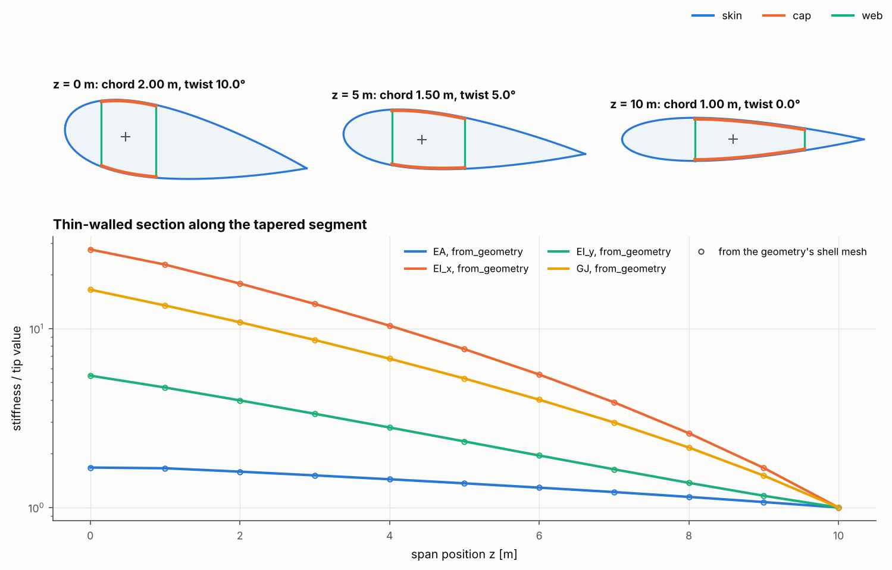
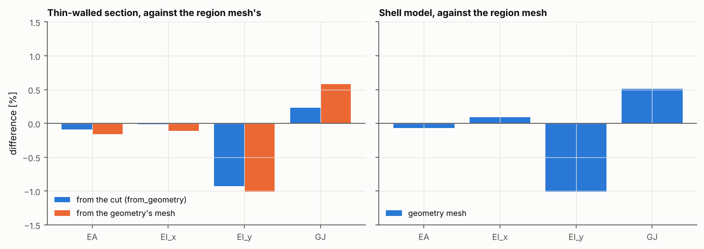
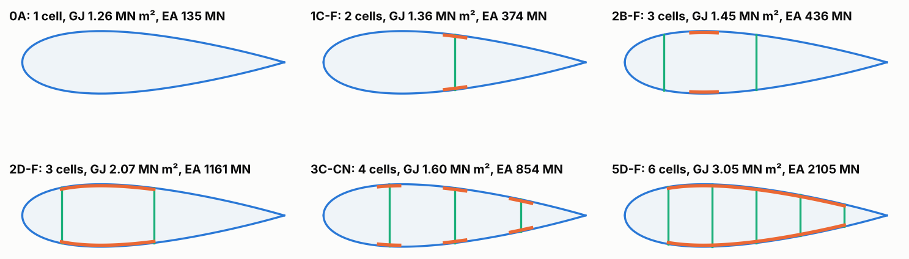

# 32 · A blade from its implicit section geometry

`blade_geometry_model` holds an implicit (signed-distance) section geometry with 40
structural layouts: skins, spar caps, any number of shear webs, cap bands and boxes.
This example lofts one of them along a blade, cuts it at any span position, and feeds
the same cut to both downstream models. `ThinWalledSection.from_geometry` builds the
beam section straight from the cut. `BladeBuilder.from_geometry` meshes the walls as
shells along the span. Both are checked against example 20's region-based shell model
of the same section, and then followed along a tapered, twisted segment.



## The model

| Item | Value |
|---|---|
| Layout | 2D-F: two flapwise shear webs, continuous box spar caps between them |
| Section check | NACA 0024, 1 m chord, pitch axis at 30% chord, webs at 18% and 48% (example 20's section) |
| Skins | E-glass/epoxy [0/45/−45]s, 0.5 mm plies (3 mm) |
| Spar caps | 16 plies of T300/5208 at 0° (8 mm), inside the skin |
| Webs | E-glass/epoxy [±45]s (2 mm) |
| Tapered segment | 10 m long; NACA 0030, 2 m chord, 10° twist at the root to NACA 0018, 1 m chord, 0° at the tip; webs straight at 0.3 m and 0.75 m from the leading edge; caps 12 mm thinning to 7 mm |
| Shells | curved Quad8 FSDT, 12 elements along the span (10 on the tapered segment) |
| References | example 20's `BladeBuilder` model with explicit regions and webs |

```bash
python examples/32_blade_from_implicit_geometry/blade_from_implicit_geometry.py
python examples/32_blade_from_implicit_geometry/blade_from_implicit_geometry.py --reuse  # redraw only
```

## Walkthrough

1. **The geometry.** A `BladeGeometry` takes the same `Station`s as `BladeBuilder`,
   a layout key, and wall thicknesses. It has no materials. The thicknesses only set
   where the walls lie: skins grow inward from the mould line, caps sit inside the
   skin, and webs end on the skin mid-surface. Any thickness can be a function of z.

   ```python
   from blade_geometry_model import BladeGeometry
   geo = BladeGeometry(stations, "2D-F", skin_thickness=0.003, spar_cap_thickness=0.008,
                       shear_web_thickness=0.002, web_positions=(0.18, 0.48))
   cut = geo.section_at(3.0)  # wall midlines, thicknesses, labels and cells at z = 3 m
   ```

   Webs sit at chord fractions (`web_positions`) or at fixed distances from the
   leading edge (`web_offsets`), as on a blade whose webs are straight. Flapwise
   (`-F`) webs stay normal to the rotor plane as the section twists, as at the root
   of the tapered segment above, while chord-normal (`-CN`) webs turn with the chord.

2. **The thin-walled section, from the cut.** Laminates are bound to the walls by
   label (`"skin_suction_surface:bay_0"`), region (`"skin_suction_surface"`) or kind
   (`"skin"`, `"cap"`, `"web"`). A spar cap is merged with the skin it is bonded to.
   Along the bond the wall is the cap and skin stacked on their combined
   mid-surface, as a cap laid on a skin is.

   ```python
   from anisotropic_section_model import ThinWalledSection
   section = ThinWalledSection.from_geometry(cut, {"skin": skin, "cap": cap, "web": web})
   section.GJ, section.EI_xx, section.shear_centre
   ```

3. **The shell model, from the geometry.** `BladeBuilder.from_geometry` cuts the
   geometry at every node section and meshes the walls' mid-surfaces between them.
   It uses the same wall graph (`SectionCut.mid_surface()`) as the thin-walled
   section. Each wall run between junctions keeps its element count along the span.

   ```python
   blade = BladeBuilder.from_geometry(geo, n_span=12).build(
       {"skin": skin, "cap": cap, "web": web}, FSDTModel())
   props = beam_section_properties(blade)
   ```

   Element sets carry the geometry's labels: `spar_cap_suction_surface`,
   `skin_pressure_surface`, `shear_web_0`, and also `skin`, `caps`, `webs` and `all`.

## Results

On example 20's section, each geometry route is compared with the same method applied
to example 20's region-based shell model:



| Route | EA | EI_x | EI_y | GJ |
|---|---|---|---|---|
| Thin wall, from the cut, against the thin wall from the region mesh | −0.1% | 0.0% | −0.9% | +0.2% |
| Thin wall, from the geometry's mesh, against the same | −0.2% | −0.1% | −1.0% | +0.6% |
| Shell (`beam_section_properties`), geometry mesh against region mesh | −0.1% | +0.1% | −1.0% | +0.5% |

The two meshes are built differently. The region mesh puts the spar cap exactly between
the web lines, and its mid-surface steps smoothly at the cap edges. The geometry runs
the cap to the webs' outer faces and steps at the bond ends. Even so, they agree to
1%.

The thin-walled section's edgewise stiffness EI_y is about 11% below the shell's, on
either mesh (2.13 against 2.38–2.41 × 10⁷ N m²). The gap is between the two methods and
the same for both meshes, so it does not come from the geometry. It is not
investigated here.

Along the tapered segment, the thin-walled section from the geometry's shell mesh
matches `from_geometry` to within 0.3% at every element-edge section. The root is 17
times stiffer than the tip in torsion and 28 times in flapwise bending. Most of that
comes from the chord: the section scales roughly with chord³ for bending and torsion.

Any of the 40 layouts can be cut and meshed in the same way:



## Limits

- The geometry has one skin thickness per section. Sandwich panels with a core in some
  regions and not others (the IEA 15 MW blade's panels against its nose skin) need the
  region-based `BladeBuilder` for now.
- The section's walls must be the same along the meshed span. A web that a fixed
  `web_offsets` drops at a thin station needs a separate mesh either side.
- Laminates are constant over each element. A cap that thins along the span is
  stepped at element boundaries, so the mesh section at an element edge takes the
  element below it.
